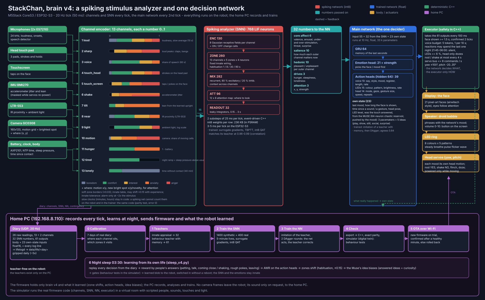

# StackChan: нейроморфный мозг

Прошивка для настольного робота **M5Stack CoreS3 StackChan**. Всё поведение рождается в нейросетях на самом
ESP32-S3. Ни деревьев поведения, ни готовых анимаций и звуков.

**Мозг v4** (`stackchan-v4/`, на нём робот работает сейчас, `mode v4`) устроен как нервная система животного:
- каждое чувство — одно число 0..1 (13 каналов: громкость, резкие звуки, голос, касание головы и экрана, тряска,
  наклон, близость, свет, движение, голод, усталость, одиночество); шкала каждого поделена на врождённые зоны скуки,
  комфорта, интереса, тревоги и гнева;
- **импульсный анализатор** (SNN, 768 нейронов) мгновенно на них реагирует и передаёт дальше 32 числа: приятно или
  нет, возбуждение, угроза, удивление, важность каждого канала, потребности, куда смотреть;
- одна **главная сеть** (GRU) выбирает одну из 21 эмоции и все действия под неё: голос-дроид, цвет и мигание
  светодиодов, голову — взгляд, кивок «да», мотание «нет», вздрагивание, дрёму;
- исполнитель на C++ держит правила безопасности: тихие ночи, бюджет реплик, пределы серв.

Устройство обеих сетей: [stackchan-v4/docs/NETWORKS_V4.svg](stackchan-v4/docs/NETWORKS_V4.svg). План (по-русски):
[BRAIN_V4_PLAN.txt](stackchan-v4/BRAIN_V4_PLAN.txt), шкалы: [BRAIN_V4_INPUT_SCALES.txt](stackchan-v4/BRAIN_V4_INPUT_SCALES.txt),
журнал: `stackchan-v4/JOURNAL.txt`.

**Платформа Б** (`stackchan-life/`, `mode life`, та же прошивка): робот, который **учится на своей жизни**. Модель
мира, пять потребностей, сеть-актёр и ночной «сон» на домашнем ПК, который переучивает их по дневнику каждого тика.
Гибридный мозг v3 (`mode brain`) тоже остаётся в прошивке; его старая папка — в истории git (метка `v3-neuromorphic`).

В проекте есть симулятор («цифровой двойник»: настоящий код прошивки в виртуальной комнате) и весь конвейер обучения
каждой сети на ПК. Документация на английском: [stackchan-v4/README.md](stackchan-v4/README.md),
[stackchan-life/README.md](stackchan-life/README.md), [ARCHITECTURE](stackchan-life/docs/ARCHITECTURE.md),
[HARDWARE](stackchan-life/docs/HARDWARE.md), [DEVELOPMENT](stackchan-life/docs/DEVELOPMENT.md).

Файлы `TODO_LATER.txt`, `RECORDING_PLAN.txt`, `VISION_PLAN.txt` и `Ideas-Tmp/` — личные рабочие заметки владельца
(по-русски), они нужны только как история и план.

Лицензия: MIT. Пароль Wi-Fi и IP устройств владельца в репозиторий не входят: шаблоны лежат в `secrets/*.example.h`.
