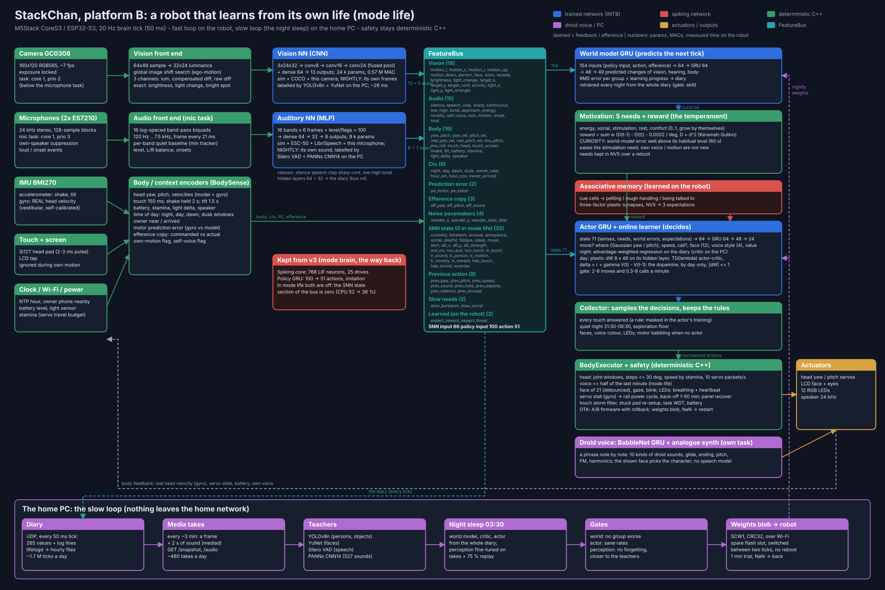

# Architecture: the hybrid brain



The map above is generated from the code's own numbers (`python3 tools/hybrid_map.py`). Colours: blue = trained
network (INT8), red = spiking network, green = deterministic C++, purple = the babble voice.

**Read this before changing a network, the behaviour, the voice or the motion.** The robot is no longer one big
recurrent network. It is a set of small specialised modules around one **FeatureBus**, connected in one closed
sensorimotor loop that runs every 50 ms:

```text
WORLD -> camera / microphones / touch / IMU -> perception -> internal state -> policy -> action -> body -> feedback -+
  ^                                                                                                                  |
  +------------------------------------------------------------------------------------------------------------------+
```

| Module | Question it answers | Kind | Size | Cost on the robot |
|---|---|---|---|---|
| Vision front end + **Vision NN** | what visually important event is happening? | CNN, INT8 | 24.5 k params, 0.57 M MAC | ~26 ms per frame, 7 fps, camera task |
| Audio front end + **Auditory NN** | what did I hear? | MLP, INT8 | 8.8 k params | filter bank ~0.27 ms per 5 ms block, net ~1.5 ms per tick |
| Body / context encoders | where is my body, what time is it, what did I intend? | C++ | - | negligible |
| **Spiking core** | what matters, how do I feel, what happened recently? | 768 LIF neurons | 212 k input + 47 k recurrent synapses, INT8 | ~7 ms per tick |
| **Associative memory** | what usually comes next, here? (learned by the robot itself) | 44 IF cue cells, 16 LIF outcome cells, 22 plastic synapses (11 cues x 2 outcomes) | 22 weights in NVS | a few µs per tick |
| **Policy GRU** | what should I do next? | dense 64 - GRU 64 - dense 48 - 51 | 37 k params | ~4 ms per tick |
| **Babble voice** | how should I sound? | GRU 48 + droid synth | 31 k params + DSP | audio task on core 1 |
| Body executor + safety | how do I do it safely? | C++ | - | negligible |

The old design (v2 "NeuroBrain": one recurrent network of 6780 cells did vision, hearing, drives, motor and voice)
was replaced. Why the split: each part is small, testable on its own, replaceable and retrainable;
the policy can be refined later (reward, real data) without touching perception; a failing part degrades gracefully.

## Platform B: the robot that learns from its own life (mode life, 2026-10-14..17)

The robot runs in **mode life** (`tools/life/ota.py mode life`; `brain` is the v3 policy below, `collector` the motor
babbling that gathered the first diary). Nothing in mode life tells it what to do; it learns what pays from its own
diary and keeps learning during the day.

```
senses -> perception (Vision NN, Auditory NN; v3)            -> bus (+ their hidden layers, "bus v4", in the diary)
       -> world model (GRU, predicts the next tick)          -> its error; a surprise eases boredom (curiosity)
       -> motivation: 5 needs (energy, social, stimulation, rest, comfort) -> reward = their easing - cost of moving
       -> associative memory: learned expectations of petting, rough handling, being talked to
       -> actor (GRU, 71 -> 24): when to move, where (a distribution), how fast, when to call, which face, which voice
          style, and the value of the situation; + its day-time correction (online learner, TD error with traces)
       -> collector: samples the decisions, keeps the rules that are not behaviour (every touch answered, a quiet night
          21:30-06:30, the floor of exploration) -> executor (physical limits) -> servos, voice, face, LEDs
```

| Part | Code | Learns |
|---|---|---|
| Motivation | `main/hybrid/motivation.*` | - (the temperament; the PC recomputes the reward with `tools/life/temperament.py`) |
| World model | `main/hybrid/world_model.*`, `tools/life/train_world.py` | every night, from the whole diary |
| Critic | `tools/life/train_critic.py` (PC only) | every night |
| Actor | `main/hybrid/actor_net.*`, `tools/life/train_life_actor.py` | every night (advantage-weighted regression); by day the online learner |
| Online learner | `main/hybrid/online_learner.*` | every tick by day: dW (8 x 48) on the actor's hidden layer |
| Associative memory | `main/hybrid/assoc_memory.*` | every tick (three-factor rule), kept in NVS |
| Vision NN, Auditory NN | `main/hybrid/vision_net.*`, `auditory_net.*`, `tools/life/train_perception.py` | every night, from the robot's own frames and sounds labelled by big nets on the PC |

**Rules you must not break (platform B).** Rules sitting next to a learned behaviour confuse the credit: the touch
answer is a rule, so its ticks are masked in the actor's training (it had learned to call 10 times a minute). The
reward is a temperament, never a behaviour ("glance every 8 s" is not allowed; "moving costs 0.0002 per degree" is).
Every filter against phantom touches must let real petting through (live test). A change that sounds at night (a
reboot) waits until 06:00.

### Methods and technologies (platform B)

What each part is built from, and why. Every network on the robot is INT8 (per-channel scales, float activations),
trained in PyTorch on the PC with quantization-aware fine-tuning, exported as C++ headers and also packed into the
weights blob that the robot can take over Wi-Fi.

**The diary: the robot's experience as data.** Every 50 ms brain tick the robot sends what it sensed, what it did and
what it felt: 265 values (the policy's 100 inputs, the 51 action values, the efference copy, the 5 needs and the reward,
the world model's errors, the online learner's TD error and value, the 64 + 32 hidden units of the perception nets and
the learned expectations). They go in UDP datagrams (`SCL1`, int16 x 1/4096, two ticks per datagram, paced at boot) to
`lifelogd` on the home PC, which writes hourly files. Log lines travel the same way. Nothing is stored on the robot
(an SD card on the shared SPI bus crashed the display). This is the training set of everything below; ~1.7 M ticks a day.

**Motivation: homeostatic reinforcement learning.** Five needs (energy, social, stimulation, rest, comfort), each 0..1,
grow by themselves and are eased by what satisfies them. The reward is the drive reduction of Keramati & Gutkin (2014):
`r = sum_i w_i (D_i(t-1) - D_i(t)) - c |dtheta|`, `D = d^2`, so a strong need speaks louder than a weak one. Moving costs
0.0002 per degree. The robot's own voice and motion do not count as novelty: otherwise it learned to entertain itself.
This is the temperament: it says what feels good, never what to do.

**Curiosity: surprise against a habitual level.** The world model's RMS errors for vision and hearing are compared
with their own slow averages (time constant 60 s): `s = clamp((e / habitual - 1.5) / 4)`. A surprise well above what
is usual eases the stimulation need like novelty does. Hearing counts half and not while the robot itself moves or
speaks. The learning progress (the slow error minus the fast error, after Oudeyer & Kaplan) is logged as well.

**World model: a predictive GRU.** 154 inputs (the policy's input, its action, the efference copy) -> dense 64 ->
GRU 64 -> dense 48 -> 49 predicted changes of the sensed values in the next tick. It is trained on the diary with
truncated back-propagation through time over windows of the episodes. Its skill is measured against persistence
("nothing changes"): `1 - MSE_model / MSE_persistence`, per group, on held-out time (the last 20 % of every run).
The spiking core's columns are zeroed, because in mode life the spiking core is off.

**Critic: value of the situation.** A GRU on a 71-value state (senses, needs, world-model errors, the learned
expectations) predicts the discounted return (`gamma` 0.995 per tick, ~10 s horizon) of the reward recomputed on the
PC (`temperament.py`). Its explained variance on held-out time is the gate number.

**Actor: advantage-weighted regression on events.** The decisions are events, not ticks: start a move (and where to:
a Gaussian for yaw and pitch, and a speed), start a call, which face (12 logits) and which voice style (4 logits). The
actor (71 -> 64 -> GRU 64 -> 48 -> 24) imitates the decisions that were actually taken, each weighted by
`exp(A / beta)`, with the critic's advantage `A` (Peng et al. 2019, AWR). Calls within 2 s after a touch are masked
out: the touch answer is a rule, and crediting it to the actor taught the robot to call ten times a minute. An
exploration floor keeps the spread of the targets from collapsing to the mean.

**The voice in mode life.** The phrase register spans 300-1580 Hz (v3: 520-1190 Hz) and the jumps between notes are
1.5x wider. In half of the calls the droid character comes from another mood than the face shown, so the 10 kinds of
sounds (giggles, squeals, growls, warbles, coos...) all occur. The kind of each note is drawn at temperature 1.8 (effective kinds 6.9 -> ~8.6 of 10). Measured on 2026-10-18 from the robot's own takes:
before this, 60 % of the voice's energy sat between 400 and 1500 Hz.

**Learning by day: an online actor-critic with eligibility traces.** On top of the actor's output layer the robot
keeps a plastic correction `dW` (8 x 48) from its hidden layer: the value and the four decision outputs. TD error
`delta = r / 0.027 + 0.995 V(t) - V(t-1)` (clamped to +-2) is the "dopamine". The value learns from traces
`e_v = gamma lambda e_v + f` (`lambda` 0.95, `alpha` 2e-4). The decisions learn from the traces of `grad log pi` of the
decisions actually taken, a Bernoulli start or a Gaussian target (`alpha` 5e-5), only by day. `|dW| <= 1`. Saved in NVS
every 10 min. Dropped when new nightly weights arrive, because the night has learned the same day from the diary. This
is the plan's three-factor rule: presynaptic activity x postsynaptic choice x a global reward signal.

**Associative memory: a three-factor spiking rule.** 44 cue cells (sounds, sights, time, being near) and outcome
populations for petting, rough handling and being talked to. Plastic synapses grow when a cue precedes an outcome and
fade when not confirmed. The expectations are inputs of the actor. Kept in NVS (format ASM2, with migration).

**Perception that learns from life: teacher-student distillation.** With the owner's consent a frame and 2 s of sound
reach the home PC every ~30 s (sound every ~90 s) (`GET /snapshot`, `GET /audio`; never further than the home network). Large
networks label them on the PC:
- YOLOv8n: persons and 80 COCO objects.
- YuNet: faces.
- Silero VAD: speech, per 32 ms.
- PANNs CNN14: 527 AudioSet classes per clip.

The robot's small nets are then fine-tuned on these labels:
- The robot's own inputs are used exactly as the firmware computed them, so there is no train/run mismatch.
- Unknown labels are NaN and carry no loss: motion cannot be told from one frame, and ticks of the robot's own voice
  are left out.
- Bangs keep their label only around an energy jump.
- Auxiliary heads on the hidden layers (the 80 objects; 15 sound groups such as dog, cat, steps, door, kitchen, servos,
  music, TV) shape the 64 + 32 hidden units that the diary logs and the world model will read, without changing any
  output of the firmware.

Against catastrophic forgetting, three quarters of every batch replay the original training sets (simulator, COCO,
the recorded sessions of this robot). Two gates decide whether a net goes to the robot:
- no drop of more than 0.03 in balanced accuracy on the old real recordings;
- agreement with the teachers on held-out takes (every 5th) is not worse.

**The night sleep: consolidation with gates.** At 03:30 (after the router's nightly restart) the PC:
1. retrains the world model from the whole diary (replay of every day);
2. retrains the critic and the actor;
3. labels the day's takes and fine-tunes perception.

Every candidate has to pass its gate:
- world model: no group worse by more than 0.005 skill;
- actor: 2-8 moves and 0.3-8 calls a minute by day, positive explained variance of the value;
- perception: the two gates above.

What passes is packed into one weights blob (`SCW1`: a table of named arrays, CRC32) and sent over Wi-Fi with
retries. The robot maps it from the spare flash slot and switches the nets between two ticks without a reboot (the
camera task through an atomic index, the old slot unmapped a second later). If any net produces NaN in the next
minute, the robot restarts. Two failed trials bring the old slot back.

**Safety and robustness, deterministic C++.** The executor keeps the physical limits (joint windows, 30 deg steps,
speed, 10 servo packets/s, stamina). The voice may take at most half of the last minute. The night is quiet
(21:30-06:30). Every touch is answered, by a rule. So is every bang (clap, knock; not the robot's own servos or voice): a quick glance aside and up, a surprised face, a squeal, only the face at night. So is rough handling: a shake makes it dizzy (a warbling sound), shaken again within a minute annoyed, then angry with a growl; tilted or lifted it is scared and squeals. The actor's training masks the calls, moves and faces of both answers. Other safeguards:
- **Firmware updates:** over HTTP with a token, A/B app partitions with bootloader rollback, confirmed after a healthy
  minute.
- **Crashes:** a core dump in flash; its summary is logged at the next boot.
- **Servos:** stalls (commanded motion without rotation on the gyro) power-cycle the servo rail with a back-off of
  1-60 min.
- **Display:** the panel is re-initialised after each power cycle and refreshed every minute.
- **Phantom touches:** a storm filter (more than 8 touches in 10 min while nobody was seen or heard for 10 min), a
  stuck-pad re-setup, and a run-time sensitivity of the touch controller (`ota.py touch`). Every such filter is
  live-tested against real petting.

**Tools.** ESP-IDF 5.5.4 in Docker, FreeRTOS tasks pinned to the two cores, LVGL faces, PSRAM for large buffers (the
internal RAM is the scarce resource). On the PC: PyTorch 2.6 (CUDA), numpy and scipy, systemd user services and timers
(`lifelogd`, `mediad`, `life-sleep`, `life-morning`), and the C++ simulator (the digital twin) for parity tests of
every net.

## Rules you must not break

1. **No network writes PWM, servo packets or registers.** Networks produce normalized intent; `BodyExecutor`
   applies joint windows, speed limits, packet-rate limits and stamina. Safety is deterministic C++.
2. **Raw video and raw audio never reach the brain**: they become features first (front ends).
3. **The spiking core must never be silent**: tonic bias, a noise current in every neuron, and slow random
   pacemakers on the bus keep it alive. Randomness the policy has to react to must be visible in its inputs (the
   `noise` group), otherwise it cannot be learned (a random choice the policy cannot see is regressed to its mean).
4. **Every module has a safe fallback** (table below). No neural failure may produce unsafe motor behaviour.
5. **Training and firmware share one definition of every interface.** `tools/hybrid/spec.py` generates
   `main/hybrid/hybrid_spec.h`; change the spec, regenerate, retrain.
6. **The firmware that is trained on is the firmware that runs**: front ends and encoders are C++ used by the
   simulator, the data generators and the robot. Parity tests (C++ vs PyTorch) must stay at ~1e-6 for the
   perception nets and ~0.01 for the spiking core (2026-10-03: mean 0.0075; a threshold network drifts apart after one
   spike that rounds differently, the attention position the most).
7. **Do not raise the servo packet rate** (10 packets/s; see HARDWARE.md).
8. **Do not put `speaker.write` back on the main loop**: the voice has its own audio task (a busy main loop made
   the sound stutter).
9. **Everything the robot says comes from the networks** (no canned sounds): the policy decides when to call and which face
   to show, BabbleNet composes every note. Without a trained BabbleNet it is silent. What is *not* learned and stays hand-written
   on purpose: the synthesizer's DSP, the call budget, the anger evidence limit (a safety net), the saccade generator, the 1.5 s minimum of a shown face (see the Voice section).

## FeatureBus

Sections, in wire order (`tools/hybrid/spec.py`):

| Section | Values | Source |
|---|---|---|
| Vision (18) | motion left/centre/right/up/down, person, face, loom, recede, brightness, light change, target x/y/confidence, activity, light x/y/strength | Vision NN (13) + exact photometric features (5) |
| Audio (15) | silence, speech, clap, sharp, continuous, low, high, tonal, approach, energy, novelty, self voice, own motion, onset, loud | Auditory NN (8) + exact measurements |
| Body (16) | yaw, pitch, velocities (model and gyro), IMU pitch/roll, touch head/screen, shake, tilt, battery, stamina, light delta, speaker | BodySense |
| Context (8) | night, day, dawn, dusk, owner near, hour sin/cos, owner arrived | clock, Wi-Fi |
| Prediction error (2) | motor, vision | BodySense, BrainLoop |
| Efference copy (3) | commanded yaw/pitch offset, commanded sound | BodySense |
| Noise pacemakers (4) | wander x/y (6 s, 8 s), wander slow (90 s), jitter (0.6 s): Ornstein-Uhlenbeck | HybridBrain |
| SNN state (25) | 10 drives, attention x/y/strength, 3 novelties, 6 traces, 2 habituations, surprise | spiking core |
| Previous action (8) | yaw, pitch, speed, sound, hold, explore, valence, arousal | policy |
| Slow needs (2) | boredom, social need, kept exactly by deterministic "body clocks" (`HybridBrain::updateSlow`, the dynamics of `teacher_drives.py`); read by the policy only (the spiking core could not count minutes of silence: its boredom stayed at 0.3-0.5) | HybridBrain |
| Learned (2) | expect petting, expect rough handling: what the robot learned by itself (see Associative memory) | AssocMemory |

Spiking core input = vision + audio + body + context + prediction error + efference + noise (66) plus two place
codes (attention-map bumps for the vision target and the light spot) = 258.
Policy input = vision + audio + body + context + prediction error + noise + SNN state + previous action + the two slow needs +
the two learned expectations = 100.

There is no sound direction and no sound prediction error (removed 2026-10-03): two microphones 5 cm apart cannot tell
a direction (HARDWARE.md), and the sound error was always 0. When the robot hears something and sees nobody, it looks
around for the source (a place the slow pacemaker picks), and the eyes take over if a person shows up.

## Perception

**Vision front end** (`hybrid/vision_frontend.*`, camera task): a QQVGA RGB565 frame is sampled to 64x48, pooled to
a 32x24 luminance image and turned into three channels: luminance with the frame mean removed (exposure drift
cancels), the temporal difference after the best global image shift (±3 px search; the head turning is
"ego-motion" and subtracted, a person walking in a still room is not), and the plain temporal difference. Exact
features need no learning: brightness, light change, brightest spot. `contrast` (spread of the luminance) says
when the picture is only sensor noise (a dark room): then `blind()` is true.

**Vision NN** (`hybrid/vision_net.*`): conv 3-8, conv 8-16, conv 16-24 (each ReLU + 2x2 max pool, fused so the full
activation map is never stored), dense 292-64, dense 64-13. Outputs: motion per region, person, face, loom, recede,
target x/y/confidence, activity. Post-processing: outputs below 0.15 are zero (a network never says exactly zero;
a constant 0.1 "person" kept boredom and social need down for ever), and `blind()` frames report no person, face,
target or approach; **a person / face is believed only above 0.30** (dead zone 0.30 instead of 0.15: a chair and a monitor give 0.2-0.5). Training data: the simulator (ground truth from the world model, labels computed at the head's
current pose so ego-motion drops out), hard-negative empty rooms with lamps and windows, and **COCO photos**
(person boxes and face keypoints, turned into the robot's 160x120 greyscale view with camera-like noise and exposure
jitter), and **recordings of this robot's own camera** (`record_vision.py`: empty rooms with the head scanning, in two lights;
a person standing in front of the parked head, and sideways / walking; person / face labels from the session, the rest masked
as NaN; they count 8x). Held-out: simulator person 0.83 recall / 0.85 precision; on real photos person recall 0.74 /
precision 0.42, face weak (a face at 32x24 pixels is a few pixels). Before the robot recordings the network saw a person in
13 % of empty-room frames (the chair and monitor); after them 1-3 %. 2026-10-03: a third empty-room session (the robot carried by hand in
all directions, head parked) and six person sessions (near, far, left, right, sitting, walking; 40 s each, head parked, the person
always in view, face label left unknown) were added; a person stepping in and out of a parked-head session is labelled per frame
from the median background (`relabel_by_background.py`). Training also got stronger augmentation (shifts, brightness ramp) and a 3x
weight on false persons / faces. A fourth and fifth empty session (head free, then **Sweep**) showed that false persons hide in directions never recorded: door frames, dark vertical corners and things by the window (5 % of the sweep frames above 0.5 before it was trained on, 1 % after). Honest test on held-out sessions: a standing person far away 96 %, sitting at the computer 16 % (95 %
once that session is in the training set), empty rooms 0-2 %. The network memorises scenes quickly: **every new room or light needs
its own sessions** (`vision_fp.py` prints the false and true person rate per recording).

**Person hold** (`BrainLoop::holdPerson`): real-camera confidence hovers around the threshold, so a person the eyes lose for a
moment is kept for 1.2 s with fading confidence; the position is remembered in room coordinates (head angle + image
offset, anchored only by a fresh camera frame) so it keeps pointing the right way while the head turns. The **green person symbol** in the corner of the screen
shows what the robot recognises (on above 0.5, off below 0.3). The `track:` log lines measure how well it follows
(see README, log reference).

**Audio front end** (`hybrid/audio_frontend.*`, microphone task): 16 log-spaced band-pass biquads from 120 Hz to
7.5 kHz on the mono mix, one frame every 21 ms (log band RMS, left/right balance, RMS, peak) into a lock-free ring.
`AuditoryNet::run` takes the last 6 frames (~230 ms) every brain tick.

**Auditory NN** (`hybrid/auditory_net.*`): input 100 = 16 bands x 6 frames + level + two flags ("I am speaking",
"my servos run"); dense 64 - 32 - 8 outputs (silence, speech, clap, sharp, continuous, low, high, tonal; the
direction output was removed on 2026-10-03). Three things make it work on a real microphone:

- every band is measured against its **own quiet baseline** (a min tracker that drops at once and rises ~0.04 per
  minute): the network sees "how far above this room's hum", so a different microphone or room looks the same;
- the classes **fade out with the level above the baseline** (full strength from +0.15): a hissing room
  is not speech;
- vision's loom / recede are not passed on while the head moves either (a person sliding into the picture as the head
  comes back looked like approach: 143 startles in a simulated TV evening);
- **loud / onset events from the microphone task are dropped while the head moves and 350 ms after**: the servos
  click and whine at 20-32k, indistinguishable from claps.

Exact measurements: energy above the baseline, novelty (distance to a slow spectral background, frozen while we
speak or move), approach (level rising for >1 s), onset, loud, own-voice level. Training data: the simulator with
synthetic sounds, **ESC-50 and LibriSpeech clips** played into the simulated room (class masks, audible slots
from energy), and **recordings of this robot's own microphone**, which count 15x: 9 quiet / servo-noise sessions and the
sessions of `RECORDING_PLAN.txt` (speech front / left / right / whispered / loud / two people, constant noise, tonal sounds; music / TV
and life at home are unlabelled `mixed` sessions kept for looking only), and, since 2026-10-03, **claps (6 sessions) and sharp sounds
(3 sessions) recorded with a parked head and a silent robot** (`kParkHead`, see DEVELOPMENT).

*Why they were re-recorded (2026-10-03).* The first clap / sharp sessions were taken with a free head: the robot turned to every
sound (own motion 85-97 % of the frames) and the "claps" in the files were its servo noise (energy ~80 against ~8-10 for a real clap).
The network learned the servos and gave real claps 0.01-0.14, usually calling them speech. In everyday operation the robot is itself
loud (head moving in ~64 % of the frames, its own voice is louder than any clap), so the ear must work against that.

*How impulsive classes are labelled.* A session has one label for all of its frames, so an impulse is found as a **jump of the newest
frame's energy above a rolling median of the room's own background** (`impulse_rows` in `train_audio.py`; rooms differ, an absolute
threshold does not work) and the label stays for the ~5 rows in which it is still inside the network's window; the rest of the session
is silence. For the robot **a clap and a knock on the table are the same thing: both labels (clap and sharp) are set on a real impulse**
("something banged"); the downstream logic uses `max(clap, sharp)`. Laying clean claps over real servo noise ("clap over servo",
`train_audio.py --mix 1`) was tried and made the servo noise itself trigger bangs: it is off (`--mix 0`).

Result on held-out real sessions (quiet / far claps, finger snaps, servo-noise silence, speech): 14 of 16 and 11 of 11 impulses heard
as a bang, none in the servo-noise silence, 1 of 5 in speech; speech 60 % of the speech frames, silence 96-100 %. In live tests on the
robot every clap is heard (0.9-1.0, also quiet ones with a microphone peak of only 2000-3000); the firmware logs `hear: clap|sharp|speech`
on each rising edge. **Open:** a clap while the head moves is still poorly separated from the servo noise (equally loud).

**Body encoders** (`hybrid/body_sense.*`): head pose and velocities (model and gyro), touch as 150 ms pulses, **shake held for 2 s and tilt
(held up, turned over) for 1.5 s and while the IMU says tilted** (a 150 ms blip was too short for the policy and the spiking
core to answer), battery, stamina, light delta, time of day (night 22:00-06:30, day 06:30-20:00, dawn
06:40-07:07 and dusk 21:25-21:52 with a 2 min ramp - inputs only, there are no songs any more), owner; the efference copy (commanded target minus pose,
commanded sound); and the **motor prediction error**: the gyro velocity versus the motion model's velocity up to 4
ticks back (the servos lag by 50-150 ms), 8 deg/s dead zone. The **vision prediction error** compares the image
shift with what the gyro says the turn should have produced; the sound prediction error is reserved (0).

## Spiking core

768 leaky integrate-and-fire neurons in 13 populations (`tools/hybrid/snn_model.py`):

| Population | Cells | Reads out |
|---|---|---|
| Attention map 12x8 | 96 | attention x/y (population vector), strength |
| Novelty | 64 | novelty of vision / audio / touch |
| Habituation | 64 | habituation to touch and to loud sounds |
| Curiosity, Arousal (also alert), Boredom, Annoyance, Social need, Playfulness, Fatigue / sleep, Music drive | 64, 64, 48, 48, 48, 48, 48, 32 | the ten drives |
| Sensory traces | 80 | touch, sound, person, motion, novelty, reward |
| Prediction / surprise | 64 | surprise |

Dynamics, two 25 ms substeps per 50 ms tick: `I = W_in u + W_rec s_prev + bias + noise`;
`v = beta v (1 - s_prev) + I`; spike when `v > theta`. `beta` per neuron spans 40 ms to 8 s. The 23 readouts are
**leaky integrator cells** (non-spiking, trained time constants 0.5 s to 30 s) over the population's spike counts:
the slow drives (boredom, social need: minutes) live there, because spikes alone do not hold minutes. This is
honest wording: the core is hybrid, spikes for the fast dynamics, the attention map and the traces, leaky cells
for the slow state.

Training (`tools/hybrid/train_snn.py`): surrogate gradients on the GPU. Targets come from a **designed drive
teacher** (`teacher_drives.py`): habituation (touches wear off over ~40 s, recover), traces with 0.5-5 s decays,
arousal from events, boredom growing in quiet over minutes (time constant ~5 min; weak sensor noise below 0.2 and the robot's own
moving do not count as stimulation, only real events and a little of its own calls: alone for 15 min it reaches 0.7-0.8), annoyance from repeated touches / loud sounds / shaking,
social need growing alone (time constant ~5 min; a clear person above 0.5, touch or speech satisfy it, its own calls a little), sleep pressure from night, fatigue and quiet, music drive in
the dawn / dusk windows with satiety after singing, attention (vision target, light spot,
wander) that wears out when it stares. Data: synthetic days (`synth.py`) plus bus sequences logged from closed-loop
rollouts. Weights are INT8 (per-column for the input projection, per-post-neuron for recurrent, per-readout);
quantization-aware in the last epochs.

C++ (`hybrid/spiking_core.*`): input drive column by column (inputs below 2 % of full scale are skipped: every
skipped column is 768 bytes less to read), event-driven recurrent scatter from packed 32-bit synapses, uniform
noise with the Gaussian's variance. Input weights live in PSRAM (flash here is DIO). Stage costs are in the stats
(`snn_stage_us=input/neurons/readout`).

**Annoyance clamp** (`HybridBrain::tick`): annoyance cannot exceed 0.12 + 1.6 x evidence, where evidence builds with
touches, shaking, tilt and loud sounds and fades in ~30 s. It is a safety net: that two or three strokes are petting and
not a reason for anger is decided by the spiking core itself, trained since 2026-10-04 on a drive teacher where touches annoy
only in a run (habituation above 0.55; test `petting`: no anger with this limit as loose as before). Without it a miscalibrated input once left the robot
angry and red for hours. The spiking core's value is passed through, but anger needs a reason.

## Associative memory (learned on the robot)

`hybrid/assoc_memory.*` is the only part of the brain that is not trained on the PC: the robot learns it while it lives,
and keeps it in NVS (namespace `assoc`, loaded at boot, saved every 10 minutes when it changed). It answers "what usually
comes next in this situation?" for two things that matter to a pet: being petted and being handled roughly.

- **Cue cells**: 11 groups of 4 integrate-and-fire cells fire at a rate that follows a cue - a voice, a bang (clap or
  knock), a tone, a steady noise, a person, a face, motion, something coming closer, a light change, the owner at home,
  night. A sound heard while the head's own servos run does not count. Each cue keeps an eligibility trace of its
  spikes (rises at once, fades over 3.5 s).
- **Outcome cells**: two groups of 8 leaky integrate-and-fire cells, driven only through the plastic synapses
  cue -> outcome; their smoothed firing rate is `expect_reward` / `expect_threat` on the bus (weak expectations below
  ~0.2 do not make them fire).
- **Learning** (three-factor, Rescorla-Wagner / dopamine prediction error): at the **onset** of an outcome - a touch
  while the robot is not annoyed (petting), a shake or a lift (rough handling) - every synapse grows by
  `0.3 x eligibility x (1 - expectation)`. Nothing is learned in the 3 s after an outcome (the robot's own reaction
  must not take the credit; its own call is therefore not a cue at all). Extinction per **episode**: when a cue's
  trace has faded (~5 s after the cue ended) and no outcome followed, its link loses 15 % (judging it earlier
  punished the second between a voice and the hand that follows). Cues present all the time (owner at home, a person
  in view) lose their link slowly while they are present without the outcome, so they keep only the base rate, and they
  learn at a third of the rate (salience 0.35): otherwise the context soaked up the whole prediction after two pairings and
  blocked the voice (Kamin blocking, seen in `learn_petting`).
  Unconfirmed links fade over days.
- The log says what it learned: `learn: voice -> petting 0.51 (learned)`, `learn: bang -> rough handling 0.43
  (fading)`; the telemetry line shows `LEARN petting=.. rough=..`.
- What the policy does with it (teacher rules): expecting petting - a happy / very happy face, an eager asking chirp
  now and then, a brighter glow; expecting rough handling - it freezes (`hold`), ducks a little, goes quiet (a touch
  is still answered) and looks scared.
- In the simulator a scenario can give the robot experience (`learned voice 0.6 0`); half of the training rollouts
  start with some, and visitors there have habits to learn (talking, then petting; coming close, then shaking).
  Tests: `learn_petting`, `learn_rough` in `behavior_test.sh`.

## Policy

`policy_gru.*`: dense 100-64 (ReLU), GRU 64, dense 64-48 (ReLU), dense 48-51; sigmoid for 0..1 outputs, tanh for
signed ones. 51 outputs:

| Outputs | Meaning |
|---|---|
| yaw, pitch (-1..1) | head target (yaw x 100 deg; pitch maps to -20..35 deg) |
| speed, vigor, hold, explore | how fast, how energetic, stay put, wander |
| gaze x/y, blink, face valence/arousal, lids | eyes and face |
| led activity, led r/g/b | the rear glow: how lively, and its colour (the teacher matches the colour to the face) |
| sound act, sound arousal/valence, voice register/slope/expr/length/rate, style calm/ask/play/grumble | the voice intent |
| invite, startle | trigger the nod series and the flinch (there is no `sing` any more: no songs since 2026-10-04) |
| emo_* (21) | **which face to show** (one per `Emotion`, the strongest wins) - learned, not coded |

**Training strategy** (the concept's stages): 1. imitation of a designed teacher; 2. DAgger: run the learner in
the simulator, relabel everything it saw with the teacher, aggregate, retrain (`dagger.sh 2`: 150 teacher + 2 x 100 learner
episodes of 8 min, with visitors, touches, noises, shakes and lifts); 3. on-device learning: the associative memory (above) learns what comes before petting and rough handling, and the
policy reads its two expectations; 4. reinforcement (PPO with a reward, `train_rl.py`): tried on 2026-10-04 and not used - it
did not beat the teacher (see DEVELOPMENT, History). The teacher (`teacher_policy.py`) is a **function of the policy input and of
its own memory along the episode** (`Memory`: when the head last stopped - the rhythm of the glances), so any logged rollout can be
relabelled from its start. It encodes:

- sleep at night (head down, lids closed, nothing else moves) and no exploring while sleepy;
- a person who just sits there (no touch, no talking) gets a glance away now and then (6 s pacemaker, 40 deg aside of where
  they sit) - the head no longer stares for hours;
- a person in view is followed **directly from the eyes** (the spiking attention wears out on a face that stays in
  the same place), at ~36 deg/s;
- a sound just heard and nobody in view: look around for the source (a place the slow pacemaker picks - the direction cannot be
  heard); loud things, loom, shaking and being lifted: a startle;
- **what it learned by itself** (`expect_reward` / `expect_threat` from the associative memory): expecting petting - a happy or very
  happy face, an eager asking chirp now and then, a brighter glow; expecting rough handling - it freezes (`hold`), ducks 8 deg, goes
  quiet (a touch is still answered) and looks scared;
- **`led_activity`**: 0.2 + arousal, play, a startle, a touch and the expectation of petting raise it; asleep it is low;
- **a conversation nearby is joined** (`conv_reply` in the teacher): while speech is heard the robot murmurs now and then with a listening
  face (curious); 0.5-3 s after a phrase ended (the sound trace has faded to 0.12-0.7) it answers in the pause with an attentive "ask"
  pip and a happy face, like a turn in a dialogue; not when irritated, asleep or at night. Simulator `conversation`: 1 call a minute
  before the change, 6 a minute (the budget) after, 75 % of them in the pauses;
- **every clear bang (clap, knock) is answered with a call**, however much the startle has habituated (`bang_reply` in the teacher; the
  executor lets a bang use the reserve of the call budget like a touch);
- **a shaken or turned-over body** (held for 2 s / 1.5 s on the bus): face Dizzy while shaken, Scared if turned upside down,
  Surprised if lifted, with a raised face arousal and a lower valence;
- exploring in glances: the scan target moves in 25 degree steps driven by the slow pacemaker, so the head is still
  most of the time (a constantly creeping head hears and feels nothing but itself and keeps arousal up). Exploring starts above
  `explore_p > 0.25`; the teacher adds 0.22 of restlessness so that a calm, not bored robot (voices in a lived-in house count as
  stimulation) still looks around every ~15 s, and a small glance while nobody is followed waits 8 s after the head last stopped
  (the teacher's memory; the GRU learned it): measured in the quiet simulator 267 glances an hour;
- **every touch is answered at once** (a short murmur within 50 ms, a lean, a happy face); repeated touches turn the
  answer into a grumble and a turn away. A touch that arrives while the head moves is held back: a full-strength
  tap (pad level 3) of 120 ms or more is real (a finger tap measured 180-250 ms), a weaker contact needs 250 ms, shorter
  blips are servo phantoms (`BrainLoop::headTouch` / `step`). A held finger is one touch: the pad drops out for a moment
  now and then, so a press ends only after 0.4 s without contact (`TouchEngine`; it used to come out as a touch every
  0.9 s and the robot grumbled at a held hand);
- **an inner life when alone**: idle babble follows curiosity and boredom smoothly (never a cliff; the babble threshold was lowered on 2026-10-03: ~205 calls an hour in the quiet simulator,
  the executor's budget lets ~6 a minute through), glances every ~15 s, moods from the slow drives (Bored, Curious, Thinking on
  the 6 s pacemaker, Sad when lonely, Happy when playful), an invitation to play (nod series + call) when lonely and the 90 s pacemaker
  swings up, a greeting when a new face appears;
- attention-seeking when social need is high: alone it calls for company; when somebody is around (in view, or the owner's
  phone at home) but does not play with it (no touch, nobody talking to it) it invites them to play (nod series and a call,
  at most every 4 min) - somebody merely in view barely satisfies the need for company; greeting the owner; **no songs** (owner 2026-10-04: the
  song bouts every few minutes after 21:25 were not wanted; the teacher never sings and the policy has no `sing` output);
- face valence from playfulness, reward, annoyance, boredom, fatigue; arousal from the drives; and the one-hot choice of the face
  (`emo_*`), computed by the rules listed in the executor section below - the network learns them, it does not run them.

Mapping of the voice outputs: register = pitch level (arousal, valence, curiosity up, sleep / annoyance down),
slope = melody direction (curious: rising, grumble / sleepy: falling), expr = expressiveness, length = phrase
length, rate = syllable rate, styles: calm = murmurs and hums, ask = questions, play = bouncy babble, grumble =
low rough complaints.

## Body executor and safety

`behavior/body_executor.*` never decides *what*. Since 2026-10-04 the network itself holds its face (it is trained against
flicker: a change of a face output from one tick to the next costs, `train_policy.py`), so the executor only shows a face that
lasted 4 ticks for at least 1.5 s (no hysteresis, no 15 s hold any more; an idle hour: 5.3 face changes a minute, was 4.3).
The head goes through a **saccade generator**: a move starts once the network's target has settled (< 2 deg in 0.3 s) or
0.6 s after the last one when the target keeps moving, big turns (40 deg+) at once. The **rhythm of the glances is the
network's**: the teacher has a memory along the episode (`teacher_policy.Memory`: a small glance while nobody is followed
waits 8 s after the head last stopped, `hold`), and the GRU learned it from what it senses (its head speed): an idle hour
267 glances (the executor's hand rule gave 256; without any rhythm 400-520). Kept in the executor: a call budget of ~6 a minute with 2.5 tokens reserved for idle babble so a touch, shake or loud sound is always answered and may
cut an idle phrase short). Motor: joint window yaw ±100 deg, pitch -20..35 deg (the joint
is wider), no single command moves further than 70 deg, at most one command per 120 ms (the servo bus takes ~8
packets/s), speed 12-110 deg/s scaled by stamina and the policy's speed / vigor; `hold` stops new moves. Two
motor primitives the policy triggers on a rising edge: a **nod series**
(three nods), a **startle flinch** (a jerk back). Face: **the policy chooses it** (21 `emo_*` outputs, the strongest wins; `applyFace` only debounces: 4 ticks and 800 ms minimum
before the shown face changes). The teacher's rules, which the network learned: sleepy from lids, Sick below 8 % battery,
Dizzy / Scared while shaken, Wink / VeryHappy while inviting, Surprised / Scared on a startle, Love while stroked, Shy for
2 s after a tap on the screen, Cool content after play, Laughing / VeryHappy / Happy by valence and arousal, Angry / Annoyed
when cross (Angry also when touched again while cross), Crying after a long loneliness or very unhappy, Sad, Confused from a
motor prediction error or a sound with no source, Curious, Thinking for a new sound, Bored for lasting boredom (each face has a
situation of the day; `audit.py` checks that all 21 appear). The rear LEDs breathe at the **virtual breathing rate** (the phase is integrated, so a changing rate never makes them jump), flash on the
**virtual heartbeat** and follow the policy's **`led_activity`** (how lively the robot is: the teacher raises it with arousal,
play, a startle, a touch and the expectation of petting): a calm robot glows at ~45 %, a lively one at full brightness, and
above ~0.55 a wave runs round the twelve LEDs, faster the livelier it is. The colour is the policy's too (`led_r/g/b`; the
teacher matches it to the face: warm for happy faces, blue for sad, magenta for surprise, red for anger). The
**virtual heartbeat** (`HybridBrain` physiology: 40 bpm asleep, 55-65 idle, 70-85 curious, 85-105 active,
110-135 excited; CPU load only nudges it by a few bpm). Sleep: head down, lids closed, the camera keeps running, the
spiking core stays alive, a touch or a loud sound wakes it through the drives.

## Voice

`voice/`: the policy's voice intent (12 values: valence, arousal, register, slope, expressiveness, length, rate,
the four styles, sing) goes to **BabbleNet**, which composes a phrase **note by note**; the **analogue droid
synthesizer** renders it.

**Why an analogue droid.** The first two voices (a child's babble, then a "droid" built from consonants and vowels) were
formant speech synthesis and sounded like a tiny human, not like a machine. A film droid is an analogue synthesizer
(whistles, fast sweeps, FM, trills) with intonation. So the voice is now notes, not syllables.

**BabbleNet** (`babble_net.*`, trained by `tools/voice/train_babble.py`): dense 56-64, GRU 48, dense 48-48, 171 outputs.
Per note: stop, **kind** (10: whistle, chirp, pip, burble, trill, warble, giggle, squeal, growl, coo), and - once per kind, the sampled kind's block is used -
**glide shape** (4: linear, fast-then-slow, slow-then-fast, scoop), **ending** (3: none, flick up, flick down) and 9
continuous values (duration 45-800 ms, pitch, slope +-18 st, loudness, FM depth, harmonics, vibrato, rate, gap). Input:
the 12-value intent, **the face being shown (21 emotions, one-hot)**, the previous note, the position. 2-8 notes a second; kinds are sampled so no phrase repeats; continuous
values get noise matched to the training residual. The training source is the **droid teacher** (`droid_teacher.py`): a recipe for each of the 21 faces (kind weights, pitch
offset, loudness, speed, glide direction, ending), e.g. Laughing = giggles, Surprised = squeals and an upward flick, Angry =
growls and low trills, Love = coos and rising whistles, Dizzy = warbles, Thinking = slow burbles, Sad / Bored / Sleepy =
long falling whistles and coos; the styles still colour it (questions end with a flick up, songs are pentatonic whistles).
On 150 sampled phrases per face the trained network stays on its recipe in 99-100 % of the notes.

**Synthesizer** (`droid_synth.*`, per sample, deterministic): a sine carrier with band-limited 2nd / 3rd harmonics and
phase modulation by a second oscillator (ratio 1.004 whistle, 2 chirp, 1.5 pip / trill, 3.01 burble); the modulation
index is limited so that no sideband passes 10.5 kHz. Kinds (10): whistle = long glide + light FM + vibrato; chirp = fast
exponential sweep with harmonics; pip = click attack with a quick pitch drop and a metallic FM decay; burble = gated steps
of random pitch (7-24 per second, 6 ms portamento) with strong FM; trill = pitch and level flutter at 20-45 Hz; warble = pitch wobble 4-13 Hz, 2-7 semitones deep; giggle = rising blips 6-16 a second; squeal = short loud rising harmonic sweep; growl = low buzz, subharmonic FM and 35-75 Hz amplitude chop; coo = soft pure tone with a slow swell. Base pitch
`520 * 2^(1.2 * register)` Hz (520-1200), notes glide up to 18 semitones from it, clamped to 280-3600 Hz. A 280 Hz
high-pass and a soft tanh saturator; level 0.17 of full scale (peaks ~5k, RMS ~2.5k: about a fifth of the first droid level, at the owner's request). Measured on a
rendered demo: < 0.6 % of the energy below 300 Hz, nothing above 10.5 kHz. Demo: `tools/voice/droid_demo.wav`.

**Audio task** (`babble_voice.*`): started after the speaker is open, core 1, priority 5 (above the microphone
and camera tasks). The main loop only hands over a request (atomic flag); the task asks the network for the next
note when less than 250 ms are queued, renders 20 ms chunks and writes them to the codec (blocking, paced by
the DMA). `voice_gaps` in the stats counts chunks that came later than 30 ms after the previous one; it must stay
0. A token bucket in the executor limits calls to 15 per minute.

Tuning knobs, no retraining needed: `Synth::level`, the register mapping in `BabbleVoice::step`, the constants in `droid_synth.cpp` (FM limits, ratios,
envelopes). Retraining (`train_babble.py`, one minute): which sounds, durations, glides, FM depth.
Checks without ears: `tools/voice/render_teacher.py` / `babble_sample.py` render phrases to WAV through the same C++ synthesizer
(level, peaks, spectrum can be measured on the file; the demo is `tools/voice/droid_demo.wav`).

## Efference copy and prediction error

The executor tells BodySense the accepted target before the head moves; the bus carries "commanded minus actual"
as `eff_yaw` / `eff_pitch` and the commanded sound as `eff_sound`. The motor error compares what the gyro
measured with what the model expected; the vision error compares the image shift with the gyro's turn; the audio
side tells the Auditory NN that "this is me" (self flag, own-motion flag), and the energy / events are muted
accordingly. `surprise` in the SNN integrates the three errors and the novelties. A servo that hangs, a hand that
holds the head, a camera that moves unexpectedly: the robot feels them as surprise.

## Failure handling

| Failure | Result |
|---|---|
| Vision NN missing / NaN | photometric features only (brightness, light) - no person, motion, target |
| Dark frame (`blind()`) | no person / face / target / approach |
| Auditory NN missing / NaN | exact measurements only, silence class |
| Spiking core NaN or mean rate > 0.4 for 2 s | `snn_resets`: reset to rest, state zeroed |
| Camera result late / stale | a frame is used if it is at most 350 ms old by a *signed* age; detector blinks are bridged by the person hold |
| Policy NaN | `policy_faults`: neutral action (hold still, calm face, silent), hidden state restarted |
| Policy value out of range | clamped to its range |
| BabbleNet NaN | phrase ends, hidden state restarted; no model: silent |
| SD missing | nothing depends on it |
| Servo stall (gyro sees no motion for two 2 s windows) | servo rail power cycle |
| Learned memory in NVS unreadable / missing | starts fresh (`learned: ...` in the boot log) |
| Task watchdog | reboot |

## Resource budget (measured on the robot, 2026-10-03)

Main loop busy 45-50 % of core 0 (brain tick 12-18 ms, of which spiking core 6-10 ms, policy ~4.4 ms, auditory ~1.5 ms,
associative memory and executor well under 1 ms); camera task ~26 ms per frame at 7 fps (core 1, priority 2); microphone
~0.3 ms per 5.3 ms block; the rear LEDs one I2C burst at most 25 times a second. Internal RAM free ~40 KB (minimum
~28 KB); flash image 2.0 MB of 4 MB; NVS holds the learned memory (96 bytes); PSRAM holds
the runtime object and the spiking core's input weights. Compiler flags `-O3 -funroll-loops` for the numeric files
(plain float, no fast-math, results bit-identical to the simulator). `-O3` took the vision net from 31 to 24 ms,
the spiking core from 7.2 to 6.3 ms. Open optimization: int8 convolutions with ESP-NN (the CNN is the largest
single cost), a smaller input projection for the spiking core.

## Tuning lessons (keep)

- A network never says zero: dead zones on every perception output, or the slow drives are held down by
  constant small false alarms.
- A network trained on simulated or foreign sounds will hallucinate classes on a real microphone: normalize
  against the room's baseline, gate by level, and add real recordings of this robot.
- A network trained where "a person in the dark" is labelled a person guesses persons in dark rooms: label what is
  visible, not what is there.
- The robot's own servos are loud for the whole movement: drop events during motion and flag the audio.
- A hearing test must be made with the robot quiet: park the head and mute the voice (`kParkHead`) or the "sound" in the file is the robot.
- A spiking core trained on short sequences under-reaches the extremes of slow drives (social need, boredom): fine-tune on long
  rollouts. The deeper cause was the *teacher*: any weak sensor noise counted as stimulation, so the drives balanced at 0.1-0.4 and
  the behaviours that need them (invite, lonely, bored) never fired. A dead zone on what counts as stimulation or company fixed it.
  The policy teacher thresholds must follow the core's real range - re-tune them after every change of the drives.
- Attention that wears out on a stationary target must not be used to follow a person; follow from the eyes.
- A head that creeps keeps arousal and noise up and never sleeps: quantize exploring into glances. But a robot that only moves when
  bored sits still in a lived-in house: measure calls and glances an hour (`autonomy_report.py`) after every retraining, the learner
  is often more passive than its teacher.
- Teach the policy by relabelling its own rollouts (DAgger); imitation alone drifts into states the teacher
  never visited.
- Events arrive as one-tick pulses; the spiking core was trained on events that fade over ~3 ticks, so the runtime
  holds them the same way.
- Heavy real-time work on the main loop shows up as audible stutter: give audio its own task.
- A time difference must be signed: `now - stamp` with `stamp` a few ms after `now` wrapped around and threw away two thirds
  of the camera frames on the robot (the simulator, with one clock, never showed it). Compare `int32_t(now - stamp)`.
- A detector tuned on photos and simulation hovers at the threshold on the real camera: measure on the robot with
  `track:` lines, record its own frames (empty rooms are the most valuable), bridge short dropouts deterministically.
- A simulator that does not produce an event (shake, lift: the IMU path was held back by "head is moving") trains a policy
  that never answers it. Check that every sense the robot has is actually exercised in the training scenarios.
- A recording session has one label for all of its frames: gate impulsive classes by an energy jump over the room's own background,
  and record them with the head parked, or the servo noise becomes the "class" (this happened: the first "clap" sessions were servos).
- Name recordings so that a new session can never overwrite an old one (a re-numbering bug destroyed a clean session once).
- Do not test "reacts to sounds" by counting head turns: a startle and a call are the reaction, and the head turn depends on the
  unreliable direction (two microphones 5 cm apart); `hearing` checks startles and calls.
- **Log what the network saw, not what the bus looks like afterwards.** The training dumps recorded the policy input after the tick, when
  the previous-action features already held the *current* action: the policy learned to copy its own output (a leak that does not exist
  on the robot) and looked fine in open loop. Found by a policy parity test that disagreed; `HybridBrain::lastPolicyInput()` is the
  input actually used.
- A head that issues many tiny moves is always "moving": own-motion flags, dropped sound events and a deaf robot. The executor has a
  dead zone (3 deg yaw / 2.5 deg pitch, doubled while no person is followed) against the network's output noise. A sound heard while
  the head's own servos run does not count as "following" (the ear takes their whine for speech: following it moved the head more).
- `pkill -f` with a pattern in the same bash line kills the shell itself; use `pgrep -x`.
