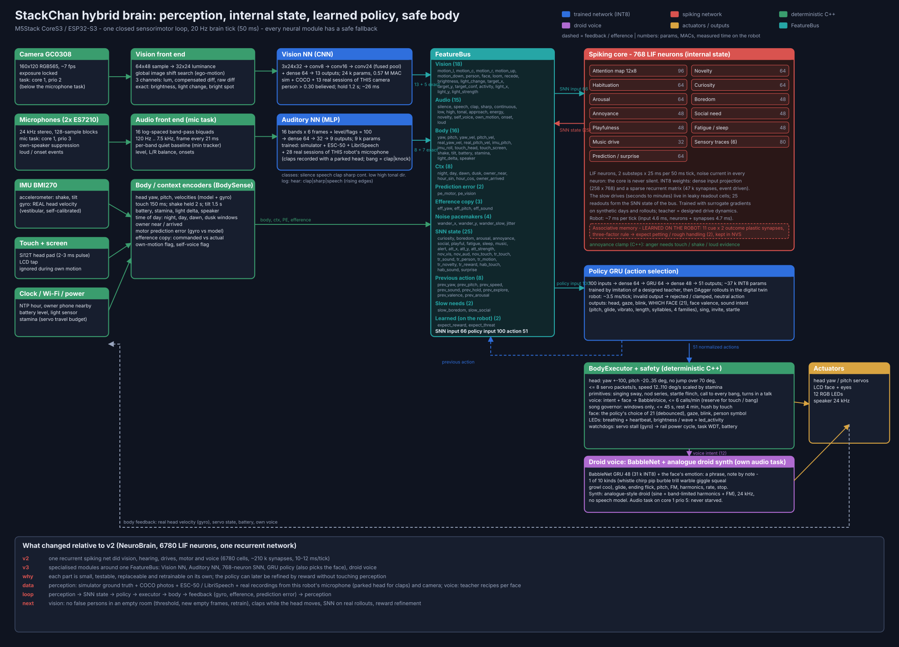

# stackchan-neuromorphic

Firmware for an M5Stack **CoreS3 StackChan** whose behaviour comes from a **hybrid brain** running entirely on
the ESP32-S3: a Vision network and an Auditory network for perception, a compact **spiking network** for internal
state (attention, novelty, habituation, curiosity, boredom, annoyance, social need, sleep, music), a small
recurrent **policy** for action selection, and a **droid voice** (a note-composing network plus an analogue-style
synthesizer). There is no behaviour tree, no state machine and no library of canned animations or
sounds; deterministic C++ only drives the hardware and enforces physical limits.



## Documentation

There are exactly four documents (plus two to-do lists for the owner, `RECORDING_PLAN.txt` for recording and `VISION_PLAN.txt` for
the camera):

| File | What is in it |
|---|---|
| **README.md** (this file) | what the robot does, current state, build / flash / monitor, configuration, repository layout, log reference |
| **[docs/ARCHITECTURE.md](docs/ARCHITECTURE.md)** | the brain: modules, FeatureBus, perception, spiking core, policy, executor, voice, failure handling, **the rules you must not break**, tuning lessons. **Read before changing a network, the behaviour, the voice or the motion.** |
| **[docs/HARDWARE.md](docs/HARDWARE.md)** | board and wiring, servos (stalls and the watchdog), gyro, microphones, speaker, camera, display, power, memory, flash partitions, flashing and recovery |
| **[docs/DEVELOPMENT.md](docs/DEVELOPMENT.md)** | the simulator (digital twin), scenarios, tests, the training pipeline for every network, datasets, recording real sounds, tools, history and lessons |

## What the robot does

- **Lives on its own** (`tools/hybrid/autonomy_report.py` measures it: in a quiet simulated room ~220 calls and ~270 glances an hour (2026-10-04), faces
  from Normal to Bored / Curious / Thinking, an invitation to play every few minutes when lonely; the rhythm of the glances is
  the network's own). The spiking core never falls silent: a noise current in every neuron and slow random
  pacemakers keep it active, so boredom grows in a quiet room, attention wanders, the head looks around in
  glances every ~15 s (steps of 25 degrees, then still), and it sometimes babbles to itself.
- **Sees** with a small CNN on a 32x24 image: motion by region (with its own head turning subtracted out),
  a person, a face, something approaching or receding, where the most salient target is, and bright spots.
  It follows a person it sees (~36 deg/s, so it keeps seeing while it turns) and keeps a person for ~1 s when the detector
  blinks. A green person symbol in the corner of the screen shows when it recognises one. In the dark it does not guess.
- **Hears** with a 16-band filter bank and a small network: speech, clap, sharp noise, continuous noise, low
  and high events, tonal sounds (not where they come from: two microphones 5 cm apart cannot tell). Everything is
  measured against the room's own quiet baseline, so a different room or microphone sounds the same; it ignores events
  caused by its own servos and its own voice. It looks around for the source of a sound, startles at loud ones and answers every clap or knock with a call and joins a conversation nearby (a murmur while people talk, an answer in the pauses).
- **Feels** head touch (every touch is answered at once: a lean, a happy murmur; too many in a row annoy it and
  it grumbles), screen taps, shaking (felt for 2 s: Dizzy / Scared), being lifted or turned over (felt for 1.5 s and while it
  lasts), and its own head motion through the gyro. A servo that does not do
  what it was told, or a hand holding the head, is a surprise.
- **Talks like a droid (R2-D2 style, an analogue-style synthesizer, not a speech model), with a voice for every face.** A small
  network composes phrases of electronic notes of **ten kinds**: whistle, chirp, pip, burble (computer chatter), trill,
  warble (slow wobble), giggle (rising blips), squeal, growl and coo, each with one of 4 glide curves, one of 3 endings and
  nine continuous knobs (120 discrete variants, endless in detail). The face being shown picks the character: laughing
  giggles, surprise squeals, anger growls, love coos, dizzy warbles, thinking burbles, sad and bored sink in long whistles;
  questions climb and end with an upward flick. No words, no human voice.
- **Does not sing.** The dawn / dusk songs were removed on 2026-10-04 (it sang in bouts every few minutes after 21:25): the
  teacher never sings and the policy has no output for it.
- **Invites you to play** when it has been alone for a while: a series of nods, calls and a wink turning into a
  big smile.
- **Shows 21 animated faces, and the policy network chooses the face** (21 outputs, one per face): mood x arousal, sleepiness,
  being shaken (Dizzy / Scared), lifted (Surprised), a nearly empty battery (Sick), inviting (Wink), a new sound (Thinking),
  a body that does not do what it expects (Confused), boredom and lasting sadness (Crying). Code only debounces the change.
- **Learns by itself what comes next.** A small plastic spiking circuit (the associative memory) links what it hears and sees
  to being petted or being handled roughly: if you always talk to it before you pet it, it starts to expect petting
  when it hears your voice - a happy face, an eager chirp, a brighter glow; if a clap always comes before a shake, it
  freezes and looks scared at the next clap. Links that are not confirmed fade. The memory survives a reboot (NVS),
  and the log says what it learned (`learn: voice -> petting 0.51 (learned)`).
- **Has a body clock and physiology.** A virtual heartbeat and breathing follow its state (40 bpm asleep, 55-65
  idle, up to ~130 excited) and show on the rear LEDs, whose brightness and running wave show how lively it is
  (the policy's `led_activity`), in a colour the policy picks too (`led_r/g/b`). It gets tired (stamina ~3 h of activity) and **sleeps** at
  night: head down, lids closed, still; a touch or a loud sound wakes it.

## Current state (2026-10-04)

| | |
|---|---|
| Brain tick | 50 ms (20 Hz); 12-18 ms of computation on the robot, the main loop is 45-50 % busy |
| Vision | front end (32x24 luminance, ego-motion compensated difference) + CNN 24.5 k params, ~26 ms per frame at 7 fps (camera task, core 1); trained on the simulator, COCO and this robot's camera; person hold 1.2 s |
| Hearing | 16-band filter bank (microphone task) + MLP 8.8 k params; per-band baseline, level gating, own-motion events dropped; trained also on 28 real sessions of this robot's microphone (claps and knocks recorded with a parked head; a clap and a knock are one "bang") |
| Spiking core | 768 LIF neurons, 258 inputs, 47 k recurrent synapses (INT8), ~7 ms per tick; 25 outputs; annoyance needs evidence |
| Policy | GRU 64, 100 inputs (incl. the two learned expectations), 51 outputs (incl. the choice of the face, the LED activity and colour), 37.5 k params (INT8), ~4.4 ms per tick; trained by imitation + DAgger |
| Voice | BabbleNet (GRU 48, 31 k params) + droid synthesizer at 24 kHz in its own audio task (core 1, priority 5) |
| Motion | speed profiles, springs, joint windows, stamina, 10 servo packets/s, gyro as vestibular sense, servo watchdog |
| Face | 21 emotions drawn from numbers, LVGL animation, 5-10 fps only when something moves |
| Learning on the robot | the associative memory (44 cue + 16 outcome spiking cells, 22 plastic synapses, three-factor rule, kept in NVS); everything else is trained on the PC (simulator + COCO + ESC-50 + LibriSpeech + this robot's microphone and camera) |
| Radio | Wi-Fi on (NTP time, owner's phone presence), Bluetooth off |

What is **not done yet**: a person detector that works in rooms and light it has not seen (retrained on 5 empty-room sessions, one of them with the head sweeping the whole range, and 8 person sessions: 0-2 % false persons on the empty recordings; the live check with the owner in view is still open; `VISION_PLAN.txt`), claps while the head moves, fine-tuning the spiking core on real data, reward-based refinement of the policy
and the voice, ESP-NN int8 convolutions for the vision net.

## Getting started

Needs Linux with Docker, an M5Stack CoreS3 StackChan on USB (`/dev/ttyACM0`), and about 10 GB of disk for the toolchain cache.
Training the networks additionally needs a PC with Python 3 and, preferably, a CUDA GPU.

```bash
git clone https://github.com/Vitalii-Khomenko/snn-robots.git && cd snn-robots
docker build -t stackchan-firmware-builder:local firmware-builder     # ESP-IDF v5.5.4 image (the toolchain is cached in ./.tooling on first build)
cd stackchan-neuromorphic
cp secrets/wifi_credentials.example.h secrets/wifi_credentials.h      # edit: your Wi-Fi
cp secrets/known_devices.example.h    secrets/known_devices.h         # edit: IPs of your phone (or an empty list)
./build.sh build && ./flash.sh
```

The trained weights are generated headers in `main/hybrid/*_model_data.h` and `main/voice/babble_model_data.h`, which are in the repository,
so the firmware builds and runs without retraining. The simulator needs only a C++ compiler (`simulator/test.sh`).

**Retraining** (optional, see [docs/DEVELOPMENT.md](docs/DEVELOPMENT.md)): create the Python environment
(`python3 -m venv tools/vocal_decoder/.venv && tools/vocal_decoder/.venv/bin/pip install torch -r tools/requirements.txt`), download the public
datasets into `../datasets` (COCO val2017 + annotations, ESC-50, LibriSpeech dev-clean), then regenerate `tools/hybrid/data` with
`prepare_clips.py`, `make_coco_vision.py` and `gen_data.py`. The owner's real recordings of this robot's microphone and camera
(`tools/hybrid/data/audio`, `.../vision`) are private and not published; record your own robot as described in DEVELOPMENT.md.

## Build, flash, monitor

The ESP-IDF toolchain (v5.5.4) runs in the `stackchan-firmware-builder:local` Docker image with its cache in
`../.tooling` (created on the first build).

```bash
./build.sh build                          # build
./flash.sh                                # flash /dev/ttyACM0 (FLASH_BAUD=460800 by default)
python3 tools/capture_serial.py --seconds 30   # bounded log capture, max 60 s, no reset
./monitor.sh /dev/ttyACM0                 # interactive idf_monitor (named container)
```

- Never run a monitor while flashing: `flash.sh` refuses if the port is in use. Recovery from a broken flash is in
  [docs/HARDWARE.md](docs/HARDWARE.md#flashing-and-recovery).
- A healthy boot shows `runtime: RobotRuntime ready`, `hybrid brain: SNN 768 neurons ... vision NN trained,
  auditory NN trained`, `voice=babble voice_gaps=0`, no `Guru Meditation`, and `stats` lines every 5 s.
- New source files under `main/` need `touch main/CMakeLists.txt` (the source list is globbed at configure time).
- After every firmware change: simulator tests, build, flash, short capture (see
  [docs/DEVELOPMENT.md](docs/DEVELOPMENT.md#workflow)).

## Configuration

**Secrets** (`secrets/`, real values for this robot, never copy them into archives, screenshots or a public
repository):

- `secrets/wifi_credentials.h` (copy from `secrets/*.example.h`, see Getting started): `kWifiSsid`, `kWifiPassword`, read at compile time by `main/net/wifi_engine.cpp`.
- `secrets/known_devices.h`: IP addresses of the owner's devices, pinged every 20 min (IPs, not MACs: phones
  randomize their MAC; give the phone a DHCP reservation). Found: "the owner is home".

**Switches** (compile-time constants):

| Constant | Where | Default | Meaning |
|---|---|---|---|
| `kCameraEnabled`, `kMicrophoneEnabled`, `kWifiEnabled` | `main/robot_runtime.cpp` | `true` | sensors / radio |
| `kDatasetLogging` | `main/robot_runtime.cpp` | `false` | 4 lines/s of policy input + action on the serial console (`tools/hybrid/serial_dataset.py`) |
| `kAudioRecording` | `main/core/debug_flags.h` | `false` | 20 lines/s of the Auditory NN's input, for recording the real microphone (`tools/hybrid/record_audio.py`) |
| `kParkHead` | `main/core/debug_flags.h` | `false` | recording aid: the head parks facing forward after the first command and the robot stays silent (clean claps / speech sessions) |
| `kVisionRec` | `main/core/debug_flags.h` | `Off` | `Free` / `Still` / `Sweep`: the camera task prints the Vision NN's input (`vframe:`); head free / parked / sweeping the whole range slowly; for `record_vision.py` |
| `kUpdateMs` | `main/motion/motion_engine.cpp` | `100` | servo packet period; do not lower (stalls, see HARDWARE) |
| `Synth::level`, the note parameters in `droid_teacher.py` | `main/voice/droid_synth.h` | 0.17 x full scale | voice loudness; colour is chosen by the network |
| `kTimezone` | `main/net/wifi_engine.cpp` | Europe/Berlin | POSIX TZ for NTP time |

Day and night: night 22:00-06:30, day 06:30-20:00 (`hybrid/body_sense.cpp`; the dawn / dusk context inputs still exist,
nothing sings in them). Without NTP time the robot has no night.

## Repository layout

```text
main/
  app_main.cpp                 starts RobotRuntime (placed in PSRAM)
  robot_runtime.*              boot order, main loop, hardware wiring, stats, servo watchdog
  core/brain_loop.*            everything between engines and brain (shared by robot and simulator)
  hybrid/                      the brain: spec (generated), vision front end + net, audio front end + net,
                               body sense, spiking core, policy GRU, hybrid brain (bus, physiology), nn kernels,
                               and the generated weight headers
  voice/                       babble_net (note composer), droid_synth, babble_voice (audio task)
  behavior/body_executor.*     executes the policy's actions: head, primitives, voice calls, face, LEDs
  audio/                       speaker output, self-sound analyzer
  sensors/                     camera (task), microphones (task), IMU, touch, presence / light
  motion/                      MotionEngine: speed profiles, springs, limits, stamina, servo packets
  ui/                          face_style (faces as numbers) + face_engine (LVGL animation)
  power/, net/, led/, core/    power rails, Wi-Fi/NTP/ping, LEDs, helpers
components/                    vendored drivers: ftservo (SCSCL), bmi270, py32_io_expander, si12t
simulator/                     digital twin: the real firmware code in a virtual room (see DEVELOPMENT)
tools/hybrid/                  training and evaluation of every network, DAgger, parity tests, dataset tools
tools/voice/                   droid teacher and trainer, prosody bank, WAV renderers (preview of the synthesizer)
tools/                         hybrid_map.py (the brain map), face_preview, capture_serial.py, serial_guard.sh,
                               vocal_decoder/.venv (the shared Python environment; the name is historical)
docs/                          ARCHITECTURE, HARDWARE, DEVELOPMENT, BRAIN_MAP.svg, NETWORKS.svg (the five networks with their sizes), faces.png
RECORDING_PLAN.txt             (owner's notes, in Russian) what to record with the real microphone and camera (sound sessions done, video sessions open)
VISION_PLAN.txt                (owner's notes, in Russian) plan for training the person recognition on this robot's camera
secrets/                       templates for Wi-Fi credentials and known devices (the real files are git-ignored)
TODO_LATER.txt, Ideas-Tmp/     owner's working notes (Russian): backlog and the original concept
```

## Log reference

**`brain:` line, every 1 s** (the whole loop at a glance, in the concept's format):

```text
VISION target=-0.42,+0.10 conf=0.73 motion=0.61/0.00/0.00 person=0.73 face=0.30 loom=0.00 | AUDIO energy=0.14 speech=0.31 clap=0.00
noise=0.00 nov=0.02 | SNN cur=0.78 aro=0.41 bor=0.22 ann=0.05 soc=0.09 play=0.30 fat=0.00 slp=0.00 mus=0.02 att=-0.36,+0.12/0.44
rate=0.08 | POLICY yaw=-0.36 pitch=+0.12 speed=0.44 hold=0.50 expl=0.00 snd=0.00 inv=0.00 val=+0.30 aro=0.45 | BODY yaw=-0.33
pitch=+0.10 | PE m=0.04 v=0.00 | LEARN petting=0.00 rough=0.00 | HEART 76 bpm
```

In a quiet room: vision all ~0, audio ~0, `rate` ~0.06-0.12 (the spiking core alive), `bor` growing slowly,
`att` drifting. `rate` stuck at 0 or above ~0.3 means something is wrong.

**`runtime: stats` line, every 5 s:** CPU of the main loop (`busy`, `active` - the same number since the voice streams from its own
task; `voice_load` is that task's render time), memory (`internal_free`, `internal_min`,
`psram_free`, `stack_headroom`), Wi-Fi (`wifi`, `time`, `owner`), per-stage cost in microseconds
(`snn_us=mean/min`, `snn_stage_us=input/neurons/readout`, `policy_us`, `vision_us=mean/min`, `audio_us`,
`mic_block_us`, `tick_us`, `tick_max_us`, `missed_ticks`, `tick_ms`), health (`snn_rate`, `snn_resets`,
`policy_faults`, `vision_nan`, `audio_nan`), behaviour (`moves`, `calls`, `nods`, `startles`, `stamina`,
`travel`, `head`), servos (`servo_packets`, `cmd_travel` vs `real_rotation` which must be close,
`gyro=learning|calibrated`, `imu=reads/fails`, `gyro_max`, `servo_repowers`), face (`face_fps`), camera (`cam_fps`, 7), microphone
(`mic_peak=still/edge/mid-turn`), voice (`voice=babble|silent`, `voice_gaps` which must stay 0, `voice_load`),
`heart`.

**Events:** `executor: move d=... speed=... explore=... att=...`, `executor: call: start`, `executor: voice:
W+ P? (865 Hz) face=Curious val= aro= cur= style=ask|play|calm|grumble|mixed` (W whistle, C chirp, P pip, B burble,
T trill, V warble, G giggle, S squeal, R growl, O coo; + rising, - falling, ? ends upward, . ends downward), `executor: emotion=N Name val= aro= lids=`,
`executor: invite: nodding`, `executor: startle: flinch`, `runtime: head touch`,
`loud sound`, `shake detected`, `tilt detected`, `track: person acquired | centred | lost`, `track: 10 s | person in N% of
M frames | centred N% | err | acquired | lost | to-centre | head | camera frames delivered / used / ticks` (how well it
follows a person, only when one was seen; the delivered / used numbers must match), `servo rail power cycle (...)`,
`runtime: learn: voice -> petting 0.51 (learned|fading)` (a link of the associative memory crossed 0.25 or 0.5),
`runtime: learned: memory loaded (N links >= 0.25)` at boot, `learned: memory saved` (at most every 10 min).

## Rollback

- On the owner's machine (not in the repository; here use git tags and history) one backup of the current state (2026-10-04, late: after the behaviour audit fixes) is kept: `../backups/stackchan-neuromorphic-v3-2026-10-04.tgz` (sources, docs, scripts,
  trained weights, all real recordings of this robot's microphone and camera; generated training data, the Python venv and build
  output are left out - they are rebuilt by the tools) and `../backups/stackchan_neuromorphic-v3-2026-10-04.bin`
  (flash it with `esptool` at 0x10000 to go back). Earlier generations (v0 Hermes, v1 pipeline, v2 NeuroBrain) were deleted on
  2026-10-03; their lessons are in DEVELOPMENT.md, History.

**Servo watchdog** (`RobotRuntime::superviseServos`): if two consecutive 2 s windows had >= 10 deg commanded and
< 1.5 deg real rotation (gyro), it switches VM EN off for 500 ms and on again and resyncs the motion model; at most
once per 10 s. Log: `servo rail power cycle (...)`. Every boot also power-cycles the servos once.

**Diagnosing a frozen head:** if the face lives but the head does not move, compare `cmd_travel` with
`real_rotation` in `runtime: stats`. Commanded 50 deg and real 0 means the servos ignore positions: suspect mode,
packet rate or power, not the brain. Check `imu` and `gyro_max` before blaming the servos: the gyro misses some moves.
