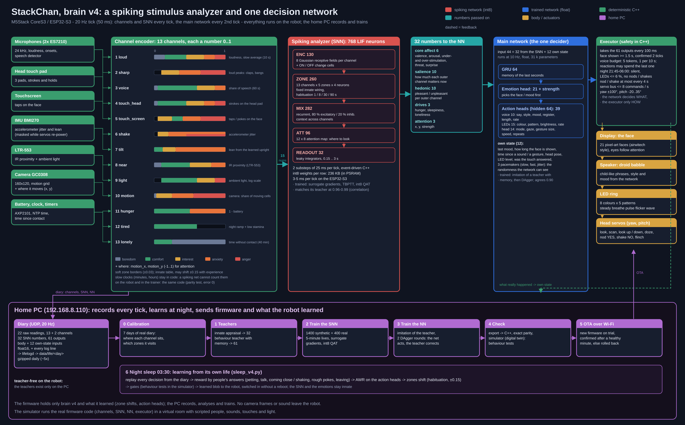
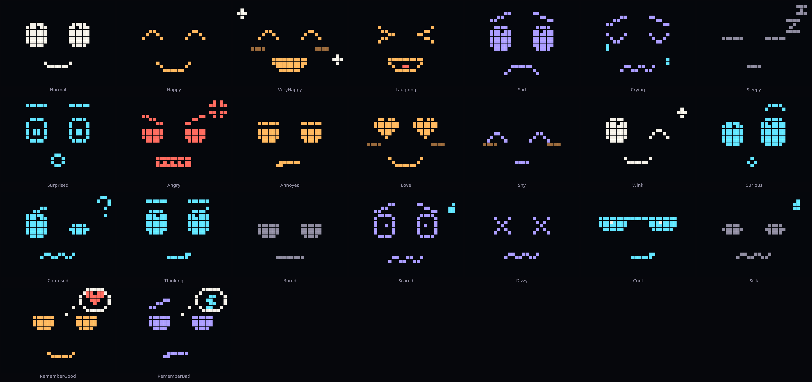

# Architecture of brain v4

The owner's idea (2026-10-24, [BRAIN_V4_PLAN.txt](../BRAIN_V4_PLAN.txt)): an animal has a fast nervous system that
evaluates every stimulus at once, and a brain that decides what to do about it. Brain v4 copies that split:

| Part | Where | Rate | Job |
|---|---|---|---|
| Channel encoder | `main/v4/channel_encoder.*` | 20 Hz | every sense -> one number 0..1 (13 channels) + "where" (5) |
| Spiking analyzer (SNN) | `main/v4/snn_v4.*` | 20 Hz | instant, innate evaluation: 32 numbers (feeling, salience, needs, attention) |
| Main network (NN) | `main/v4/nn_v4.*` | 10 Hz | the one decider: an emotion and every action |
| Executor | `main/v4/v4_executor.*` | 20 Hz | the "muscles": how to show it, inside safety rules |
| Brain loop | `main/core/brain_loop.*` | 50 Hz pass, 20 Hz tick | wires the engines to all of the above; the same code runs in the simulator |



One file defines every name and size on both sides: `tools/v4/spec_v4.py` (channels, zones, SNN outputs, the main
network's inputs and outputs, emotions, LED colours and patterns, head modes, the diary columns). `./py spec_v4.py`
writes `main/v4/v4_spec.h`.

## 1. Channels and zones

Each channel is a number 0..1. Its scale is divided into innate **zones**: boredom, comfort, interest, anxiety, anger
(not every channel has all five; zones may overlap, borders are soft over ±0.03). The table is the owner's
([BRAIN_V4_INPUT_SCALES.txt](../BRAIN_V4_INPUT_SCALES.txt)) and may later shift by up to ±0.15 with experience.

**Innate tolerance** (2026-10-25, the owner: "it gets cross too fast at sounds and touches - every input twice as
tolerable"): before the analyzer every channel with an anxiety or anger zone is warped so that its alarm border a is
reached only at the raw level min(2a, a + 0.6 (1 - a)) - touch_screen 0.40 -> 0.76, shake 0.20 -> 0.40, motion 0.25 ->
0.50, tilt 0.30 -> 0.58, loud and touch_head 0.70 -> 0.88, near 0.80 -> 0.92 (`ZoneShift::tolerant`). Sharp sounds
saturated at one bang, so their scale is twice as wide instead (6 = full, was 3) and they are not warped. In the
simulator 25 s of pokes every 0.8 s no longer anger it; the first annoyed face comes after ~58 s.

| # | Channel | Made from | Zones (low -> high) |
|---|---|---|---|
| 1 | loud | the ear's loudness over the room's floor, 10 s average x 1.6 | boredom, comfort, interest, anxiety, anger |
| 2 | sharp | loud peaks (claps, bangs, knocks), each weighted by strength (1-6), 15 s memory, 6 = full (3 until 2026-10-25) | interest, anxiety, anger |
| 3 | voice | share of speech over 60 s (Auditory NN speech > 0.4) | boredom, comfort, interest, anxiety |
| 4 | touch_head | strokes on the head pad (weight by pad level), holding counts, 30 s memory | boredom, comfort, interest, anxiety, anger |
| 5 | touch_screen | taps on the face, 30 s memory | interest, comfort, anxiety, anger |
| 6 | shake | spread of \|acceleration\| over 0.5 s (0.03 .. 0.8 g), decays over 3 s | interest, anxiety, anger |
| 7 | tilt | lean from the learned upright (the head's own pitch excluded) | comfort, interest, anxiety |
| 8 | near | IR proximity over its baseline (600 counts = full) | boredom, comfort, interest, anxiety |
| 9 | light | ambient light, log scale (20000 counts = full) | comfort, interest, anger |
| 10 | motion | share of the picture that moves (head's own turn removed) x3, rising in 0.5 s, falling in 4 s (a 5 s average x1.5 until 2026-10-25: a person moving about read ~0.01) | boredom, interest, anxiety, anger |
| 11 | hunger | the larger of 1 - battery (always 0 on USB: [BODY](BODY.md) step 0) and 1 - body budget / 0.7 (section 5; not squeezed by the innate tolerance: the body's own need) | comfort, anxiety |
| 12 | tired | 0.75 x the night ramp (21:00-21:45 up, 06:00-06:45 down) + 2 x the sleep pressure above a usual day's at this hour (section 5, [BODY](BODY.md); 0.25 x (1 - servo stamina) until 2026-10-27, and the stamina never fell) | comfort |
| 13 | lonely | 1 - exp(-t / 40 min) since the last contact (touch, speech, near; motion caps it at 5 min) | comfort, boredom |
| - | motion_x, motion_y | where the motion is (-1..1) | for attention |
| - | light_x, light_y, light_spot | the picture's brightest spot (a lamp, a window; -1..1) and how NEW it is (0..1): its excess over how bright that place in the room has looked (13 directions 15° apart from head yaw + place in the picture; each keeps its usual peak, up in 4 s of frames, down in 2 min, forgotten in 15 min; novelty starts 0.15 above it), less what was already looked at (habituation over 3 min) - 2026-10-25. Read from every frame that is not dark and taken while the head turns slower than 12°/s (2026-10-26: the calm head turns ~40 % of the time; frame_ok 0.5 in the diary = a frame for the spot only) | for attention |

A sensor counts as working only while it reads: the proximity and light sensor within the last 2 s, the IMU within
0.5 s (since 2026-10-28, an audit: after an I2C failure the last values and the ok flags stayed - a frozen sensor read
as someone near or a lit room, and a dead gyro's silence looked to the servo watchdog like a hung head). A channel
whose sensor does not read holds its value (proximity, light) or reads no tilt and shake (IMU).

Slow clocks (minutes, hours) are computed in code, not by the SNN: a spiking network cannot count minutes (v3's lesson,
2026-10-03). `tools/v4/channels.py` is the same encoder for training; a parity test keeps them identical (error 0).

## 2. The spiking analyzer (SNN)

768 leaky integrate-and-fire neurons in four layers, two substeps of 25 ms per tick, event-driven C++ with int8 weights
(per-row scales, 236 KB, copied to PSRAM at boot): 3-5 ms per tick on the ESP32-S3.

| Layer | Neurons | What it does |
|---|---|---|
| ENC | 130 | per channel 8 Gaussian receptive fields over 0..1 + an ON and an OFF cell (a value that jumps fires at once) |
| ZONE | 260 | 13 channels x 5 zones x 4 neurons, fixed innate wiring from the zone table; the 4 neurons of a zone tire with time constants 1 / 8 / 30 / 90 s (habituation: a steady stimulus fades, a new one stands out) |
| MIX | 282 | recurrent pool, 80 % excitatory / 20 % inhibitory (Dale's law), 12 % connectivity: context across channels |
| ATT | 96 | 12 x 8 attention map: a bump where motion is and one where a new bright spot is, weighted by salience |

A readout of 32 leaky integrators (0.15 .. 3 s) reads all 768 neurons:

- **core affect (6):** valence, arousal, under-stimulation, over-stimulation, threat, surprise
- **salience (10)** and **hedonic value (10)** of each outer channel (1-10)
- **drives (3):** hunger, sleepiness, loneliness
- **attention (3):** x, y, strength - the most salient thing with a place: movement in view, a touch, someone at
  the face, a new bright spot (2026-10-25)

It is trained to embody an innate appraisal (`tools/v4/teacher_snn.py`, built from the zone table: zone valence and
arousal, salience per zone, jumps as news, habituation) with surrogate gradients and truncated backpropagation through
time; the last 30 % of the epochs run with int8 fake quantisation, as on the robot. The SNN only gets numbers and knows
which channel each comes from; it does not choose emotions.

## 3. The main network (NN)

One network decides everything (the owner's choice: one decider, the voice is only a synthesizer):

```
input 55 = 32 SNN numbers + 23 own state -> GRU 64 -> emotion head: 21 emotions (softmax) + strength
                                                    -> [GRU state, emotion] -> hidden 64 -> action heads (39)
            SNN mood --> Muse (64-neuron reservoir) --> 3 pacemakers + 5 ideas (part of the own state)
   acts + answers --> contingency detector (section 5) --> agency, answered, ignored, what works (own state)
```

- **Own state (23):** last valence and arousal, how long the face has been shown, time since a sound and since a
  gesture, head yaw and pitch, LED level, whether the last touch was answered, three pacemakers (slow, fast,
  jitter: random processes the network can see, so its "spontaneous" choices are learnable and reproducible), the
  Muse's five ideas (below) and, since 2026-10-27, the six numbers of the sense of "I did that" (section 5,
  [CONTINGENCY](CONTINGENCY.md)).
- **The sense of "I did that"** (CONTINGENCY step 3, 2026-10-27). The teacher (`teacher_nn.py`) does the following,
  and the network learned it:
  - **Joy of control:** an answer to its own act brings joy: happy, very happy, laughing or wink; "very happy" when
    it comes after being ignored (the repair).
  - **Circular reaction:** the answered act comes again 1.5-3.5 s later, at most 3 times in a game; an answered face
    comes back as another joyful face (varied).
  - **Still face, bids first:** ignored by someone around (above 0.45), it bids: an asking call every 5 s, a look
    to where someone was seen.
  - **Still face, then withdrawal:** above 0.75 it goes quiet and sad with the head down. Never angry. Not while
    sleepy.
  - **Waiting for the answer:** while the world answers (agency above 0.15), after a call the head holds still
    2.5 s, as if waiting. Idle babble comes 1.7x more often.
  - **Training:** the people who answer are simulated (`contingency.AnswerWorld`), in stretches of 1-5 minutes:
    nobody (35 %), random answers (15 %), answers to some kinds of act with p 0.5-0.9 after 0.6-3 s (30 %), and
    someone who never answers (20 %). They are seen through the same detector as on the robot, in a closed loop
    with what the network really does (DAgger).
  - **An answer is felt too:** its mean trace in the analyzer's numbers (touch salience ~0.35 fading, pleasant,
    a short surprise) is written into the recorded life (`contingency.inject`).
  - **A person's pace:** someone answers at most once in 6 s, not every call of a ping-pong.
  - **Two lessons from the first attempt the same morning:**
    - Without the felt trace, every touch reaction cancelled the game. The answered act came again less often
      than by chance, because on the robot an answer *is* a touch. Now only a fright ends the game.
    - Without the pace, the teacher called 412 times an hour.
- **The Muse** (2026-10-26, the owner: "for creativity and unpredictability an additional network that gives new
  signals"; `main/v4/muse_v4.cpp`, twin `tools/v4/muse.py`, concept [CREATIVITY](CREATIVITY.md)). It has 64 leaky tanh
  neurons in three time scales (16 x 0.5 s, 24 x 3 s, 24 x 60 s), fixed seeded weights a little past the edge of
  chaos (spectral radius 1.1), noise from BrainV4's generator, and the SNN's mood (valence, arousal, under, over,
  threat, attention, sleepiness, loneliness) pushing it gently.
  - Its first three readouts replace the blind pacemakers: the same spread (0.6) and time scales, but now they
    depend a little on the room and the mood.
  - Five more readouts are ideas: **play** (short lively calls in a row, a wave of colour), **show** (a face it
    rarely makes, a flicker), **still** (no babble, the head holds, the lights breathe low), **social** (an asking
    call, a look to where someone was last seen) and **surprise** (a nod dance, a burst of light). Each idea is a
    reservoir readout plus a direct mood push: play from lively and content, still from sleepy, social from
    lonely, surprise from bored.
  - It gets bored of its own ideas: an idea it keeps having fades (habituation over 90 s).
  - The teacher (`IDEA_ACTS` in `teacher_nn.py`) acts an idea above 0.5 (lower when bored) for 2.5-10 s, at most
    one every 12 s. It does so only when nothing calls for a reaction: no touch, fright or threat, not sleepy, not
    at night.
  - The night learns one bias per idea (`muse.bias` in the learned blob, section 7).
  - Cost: ~5 k multiply-adds and 64 Gaussian draws per decision.
- **Outputs (61):** 21 emotions + strength; voice 10 (say, 4 styles: calm / ask / play / grumble, arousal, valence,
  register, length, rate); LEDs 15 (8 colours, 5 patterns: steady / breathe / pulse / flicker / wave, brightness,
  rate); head 14 (9 modes: hold, look, scan, nod, shake, flinch, look down, look up, doze; gaze yaw / pitch; gesture
  amplitude, speed, repeats).
- Float, ~31 k parameters, runs every second tick (10 Hz), the first 5 s after a boot only settle the SNN.
- Trained by imitation of a behaviour teacher with memory (`tools/v4/teacher_nn.py`) on the SNN's outputs, then three
  rounds of DAgger (the network acts, its choices feed back into its own inputs, the teacher labels what it really
  visits). Emotion agreement with the teacher when acting alone: 0.84 (real days 0.82; 0.91 / 0.94 before the Muse, whose idea acts are harder to imitate). The head modes are
  class-weighted in training (rare ones count more: without it the network looked around 8x less than its teacher).
- **Every mood moves its head** (2026-10-25, the owner: angry or upset it did not move its head at all). By day the
  teacher gives each emotion its own manner (`teacher_nn.py MANNER`): calm looking around (normal), lively glances a
  little up (happy, wink), bobbing (laughing), a hanging head that sways slowly (sad, crying, sick), nodding off
  (sleepy), quick looks up (surprised), turning away from whoever it attends to (angry abruptly, annoyed slowly, shy
  away and down), a gentle sway (love), wide inquisitive looks (curious), this way and that (confused), up and aside
  (thinking), a slow wide wander (bored), nervous glances (scared), wobbling (dizzy), a slow sweep (cool). The gaze is
  a function of the three pacemakers the network sees (how wide, how fast, how jittery per mood), so the network
  learns it exactly and no two minutes look the same; with someone in view the head stays on them and moves around
  them. The network acting alone: hold 50 % -> 2.5 % of the time.
- **Looking round the room** (2026-10-25, the owner: the head stayed within ~15° of the centre and nothing in the room
  interested it). The yaw amplitudes are 1.4x wider and the wandering stays out at the sides (sign x sqrt), so the
  head looks round the room instead of wobbling round the centre (simulator, a day alone: |yaw| > 15° 63 % of the
  time, > 30° 28 %, up to ~42°). 2.0x was tried on 2026-10-25 evening and taken back the next day: little wider
  (a day alone -36..24°) and a new lamp drew the head no more than chance (0.30 vs 0.27). Spreading the gaze in the
  executor ran away: the network follows its own head yaw, and the head stayed at -95°. The width comes from the
  executor's curious glances since 2026-10-26 (section 4). Something moving in view (attention > 0.12, was 0.2) turns the head to it: the
  direction is the head's own yaw plus half the picture position (the camera is ~62° wide; it used to be taken as
  an absolute direction, wrong whenever the head was turned), and a moving thing makes it curious. A light coming
  on (light salience > 0.12, pleasant) makes it curious too: a wide look round, since one light sensor has no
  direction from the light sensor alone - the camera's bright spot gives it (below).
- **Seeking** (2026-10-25, second step): the motion sense is three times stronger and quicker (channel table), and
  the camera's brightest spot reaches the analyzer (light_x / light_y / light_spot): a lamp switched on in view or a
  window coming into view is new and draws attention, the head turns to it, and the interest fades as it gets used to
  it. Something new and strong in view (attention > 0.25) makes the robot curious. Novelty is kept per place in the
  room, not for the picture as a whole: with one memory a lamp switched on to the side read "old" right after the
  head had seen a white cup. After a look at something (attention > 0.12) the head keeps watching that place for
  ~10 s, with small moves round it: someone who walked and then stood still vanishes from the motion sense in a few
  seconds, and the head used to wander off.

## 4. The executor

The network decides **what**; `V4Executor` decides only **how**, inside fixed rules:

| Output | How it is shown | Rules |
|---|---|---|
| face | the chosen emotion: 21 pixel-art faces (below); eyes follow the SNN's attention | a choice must last 2 ticks; a shown face stays >= 1.5 s |
| head mode | the chosen mode, debounced | a mode counts once the network has kept it for two decisions (a one-decision wish - a flinch at a touch's very start - is ignored) |
| voice | the droid babble (BabbleNet + synth) with the network's style and mood | call budget 5 tokens, 1 per 10 s (a reaction may spend the last one); **silent 21:45-06:00**; without a clock (no Wi-Fi / NTP) for the first 2 min of a boot and then while the room is dark (lit in the last minute: day; until 2026-10-28 daytime rules after 2 min whatever the hour) |
| LEDs | colour, pattern, brightness, rate | brightness <= 6 % at night |
| head | look / scan to the gaze, look up / down, doze; gestures on the network's wish: nod 5-12°, shake 5-14°, 1-3 repeats; flinch +6° at 60°/s, at most one every 15 s (12° at 160°/s until 2026-10-25 evening, 8° at 90°/s and every 1.5 s until 10-26: 9 flinches in 13 minutes at the owner's sounds) | nod / shake at most every 4 s; flinch every 1.5 s at most; no nod, shake or flinch at night; gaze moves at most every 4 s and only for >= 12° yaw / 8° pitch (the servos hang more often the more packets they get; 2.5 s / 8° until 2026-10-25); with nothing attended for 10 s (attention <= 0.12) the wandering gaze keeps a place 5-11 s (shorter in a lively mood) and turns only for >= 20° (2026-10-25 evening, the owner: a whizz of the motors every few seconds - 11 moves a minute of ~14°); a turn of 0.8 s or more is eased (half a cosine, peak 7-20°/s; HARDWARE, servos); something new in view (attention > 0.12) is turned to 1.5x faster, still eased (at the wander's speed a lamp was no longer new when the head got there; 2.5x jerked right after a glance), aimed once (head yaw + attention x 30°, within ±75°) and again only after the head has been still 0.8 s - the picture is not renewed during a turn, and re-aiming every tick from the turning head ran after a lamp at the picture's edge to -88..-100° (2026-10-27, the owner: "it jerks its head far left and back"); curious glances (2026-10-26, the owner: "add creativity and unpredictability"): while it wanders by day, at a random moment every 40-150 s the head turns 40-70° to one side at 12°/s (the other side when it already looks aside), a little up or down, looks 4-9 s and goes back (55-90° at 20°/s for 3-7 s the first hours: the owner saw the head jerk far aside and back) - its own xorshift generator, so the simulator's world keeps its random numbers (simulator, a day alone: yaw -57..48°, beyond 30° 34 % of the time, 5.5 moves a minute); the hold of a place is drawn by chance too; at night the head only sinks into the doze (no look / scan); gesture keyframes <= 8 commands/s; yaw ±100°, pitch -20..35° |

What really happened (shown face, said, gestured, LED level) goes back into the network's own state. The head pose
in it is the network's own gaze, eased (0.7 old + 0.3 new, in the decisions it chose look or scan), exactly as the
teacher keeps it (`teacher_nn.Teacher.apply`): the only meaning these two inputs had in training. Until 2026-10-28 it
was the real head: yaw / 60 matched, but pitch / 30 had the sign the other way round and 0.17 off (gaze pitch > 0
looks down, a positive degree looks up), and the head's own moves the teacher never counts came in as well (a sad look
down, a glance to 70°, a nod). Matched, over 12 simulator seeds: a joyful face 1.5 s after a pet 0.72-0.74 (0.23
after an answered act, 0.46 after a random pet before) - after any pet alike, so the joy of *being answered* is still
not learned; cross when poked in 11 of 12 runs (7 before); twice the share of happy / loving / winking faces; still
never angry when ignored.

**The faces** (`main/ui/pixel_face.*`, 2026-10-24): pixel art in the style of the owner's site airwitech.com - square
pixels of 10 px on a 32 x 24 grid, a dark screen, the site's palette (paper for calm, amber for joy and affection,
cyan for attention and surprise, violet for sadness and fear, muted grey for tiredness, coral for anger). Every emotion
is composed of hand-drawn glyphs: eyes, brows, a mouth and extras (tears, Zzz, hearts, a question mark, an anger mark,
sparkles, sweat, sunglasses). Everything moves in whole pixels: the gaze shifts eyes and brows, blinks close the eyes
to a line, tears fall, Zzz rise, hearts beat, dizzy eyes spin, laughter bounces, fear trembles; a new emotion dissolves
in pixel by pixel (0.42 s). `face::kPixelFace = false` brings the earlier smooth vector face back (`face_style.*`).

**The speaker button** (2026-10-25, the owner): a small grey speaker in the bottom left corner of the pixel face (coral
without its wave when silent). A tap opens the volume bar in the mouth's place for 5 s: minus, 10 steps, plus; a tap
on a step or on minus / plus sets the level at once (`AudioOutput::setLevel`, codec volume 0-100 on a dB scale; level 8
= the volume 90 of before), the voice beeps at it, and it goes into NVS "v4" "vol" 3 s after the last tap. These taps
are not touch_screen events for the brain; a tap on the face above the open bar closes it and is one.
`tools/face_preview/run.sh` draws every face on the PC exactly as the robot does.



## 5. The brain loop and its filters

`BrainLoop` (shared by `RobotRuntime` and the simulator's `SimRuntime`) runs every 20 ms pass and ticks the brain every
50 ms. Hand-written filters that keep the senses honest (each found on the real robot, see HISTORY):

- **Own motion:** the servos click up to 32k into the microphone: loud / onset events are dropped while the head moves
  and 700 ms after (the servo glides on after the motion model has arrived); camera frames taken while the head turns are not used; the servos' own share is taken off the
  shake channel; the IMU is ignored for 3 s after a servo power cycle. The servo rail is on only while the head moves
  (HARDWARE.md); its switching on or off raises the microphone threshold for 400 ms (the camera keeps looking).
- **Own voice:** the microphone is muted while the voice plays; the ear is told when the robot itself speaks.
- **Speech must be a voice** (2026-10-27, CONTINGENCY step 2). The ear's speech class fired ~250 times an hour, on the
  tail of the robot's own voice and on the servos' whine (~6 kHz) and clicks (recordings, `tools/v4/sound_check.py`).
  - `perception/voice_check.cpp` (twin `tools/v4/voice_check.py`) runs on the microphone task:
    high-pass 70 Hz, low-pass 900 Hz twice, 4 kHz;
  - every 25 ms it takes the periodicity at 80-400 Hz (normalized autocorrelation) and the level against the
    room's floor;
  - a voiced frame needs periodicity > 0.6 and the level 6 dB above the floor; voice = a ~250 ms average.
  - Speech below voice 0.3, or within 1.5 s after the robot's own phrase, is held at 0.3 (below the voice
    channel's 0.4).
  - On recordings the owner's speech passes and the robot's own sounds do not. Speech time: 9.9 % -> 0.5 % of a
    minute with nobody talking, 14 % -> 5 % live. The robot equals the twin: correlation 0.986.
- **Head pad phantoms:** a touch during a fast move counts only if it is held (level 3 >= 120 ms, level 2 >= 250 ms);
  more than 8 touches in 10 minutes with nobody heard, moving or near in those 10 minutes are pad noise.
- **Sharp sounds:** only loud peaks from ~6000 count (weak taps and words do not); the boot click (first 10 s) is not
  a bang.

**The body** (`main/v4/body_v4.cpp`, twin `tools/v4/body.py`, concept [BODY](BODY.md), step 1 2026-10-27): after
the executor, every tick, the sleep pressure (Borbely's process S):
- **load:** a 10-minute average of head travel, calls and the analyzer's arousal against a usual day (2.3°/s, 5.5 a
  minute, 0.16); load = 1 + 2 x (effort - 1), 0.25 .. 3;
- **awake:** the pressure rises towards 1 with 12 h / load; **asleep** (night rules, or the sleepy face shown: a nap)
  it drains with 3 h;
- **felt:** the tired channel takes only the pressure above `usual(hour)` (a usual day's curve: 0.05 at 06:00, 0.42 at
  noon, 0.74 at 21:45 - the clock's alerting signal), x2;
- the next tick's `raw_stamina` = 1 - pressure (diary); the `stats:` line shows `sleep_pressure=` and `load=`; a
  reboot starts on the usual curve.
- **the body budget** (step 2): 0..1, spent by the load (empty in 50 h at load 1, half as fast with someone near or
  talking), by threat / over above 0.3 (10 min at full) and by every servo rail power cycle (-0.0007); refilled by
  sleep or a nap (2 h) and by each gentle pet or tap (6 % of what is missing). The next tick's `raw_budget`; hunger
  feels it below 0.7; `stats:` shows `budget=`; a reboot starts at 0.85.

**The sense of "I did that"** (`main/v4/contingency_v4.cpp`, twin `tools/v4/contingency.py`, concept
[CONTINGENCY](CONTINGENCY.md); step 1 2026-10-27 06:29 wrote the diary only; since step 3 the main network sees it,
section 3). After the executor, every tick:
- **Acts:** what the robot did: a call, a gesture, a face change.
- **Answers:** what came from outside: a gentle pet (weight 1.0) or tap (0.8), a new speech onset (0.6; the ear
  already holds back the robot's own voice and its tail, below), someone near (0.5), motion while the head is still
  (0.3).
- **Credit:** an answer 0.5-4 s after an act goes to the latest act. Acts within 3 s after an answer are reactions
  and do not count.
- **Contingency per act kind:** answered acts (leaky, ~5 min, with a prior of 3 acts at chance), minus the chance of
  an answer in such a window anyway. The chance comes from the background rate at moments without acts while
  someone is around (a touch, someone near or moving in view in the last 2 minutes; leaky, ~30 min).
- **Outputs (diary `ct_*`):**
  - agency (the best kind, 0..1);
  - answered (a pulse that fades in ~3 s);
  - ignored (rises by 0.1 per unanswered call or gesture with someone around: a face is not a bid; a pet, a tap
    or speech resets it; fades in ~5 min);
  - call, gesture, face contingency (-1..1).
- **Log:** `contingency: face answered by pet after 1.9 s (agency 0.00)`.
- **First measurements:** 2026-10-26 replayed by the twin: 613 credits, 594 of them by speech (noise), all kinds
  of act ~0 above chance.

## 6. The diary

Every tick goes to the home PC over UDP (`main/net/life_log.*`, kind 3 datagrams, four ticks each, float16), with
every log line. Columns (`spec_v4.DIARY`, 174): the 27 raw readings the channels are made from, the 18 channel values
(after the zone shift: what the analyzer saw), the 32 SNN numbers, the 61 network outputs, what the body did (head
yaw / pitch, shown face, said, gestured) the main network's 23 own-state inputs of its last decision, the 6 numbers of the contingency detector (`ct_*`, section 5), and the ear before the voice check (`ear_speech`, `ear_voice`; `raw_speech` is what the channels got). `raw_stamina` is 1 - the sleep pressure since 2026-10-27 (1.0 before). With the raw
readings any day can be re-encoded after a change of the channels; with the own state every decision can be replayed
exactly on the PC (stage 6). Flags: bit 0 brain v4 drives the body, bit 1 night rules, bit 2 the main network decided
this tick. `tools/robot/lifelogd.py` stores it, `tools/v4/diary.py` reads it (also the older layouts by column name: 135
values until 2026-10-24 14:30, 147 until the camera's bright spot and the head yaw as a raw reading came in on 2026-10-25, 154 until
the Muse's ideas on 2026-10-26, 159 until the contingency detector on 2026-10-27, 165 until the ear's columns the same morning, 173 until the body budget (`raw_budget`) that evening; missing columns
are NaN).

Every 5 s the robot logs three lines: `stats:` (CPU, memory, timing, servos, sensors, voice, diary counters), `v4:`
(raw light / proximity, the 13 channels, the SNN's mood, the network's state, face, calls, gestures) and `power:`
(rails of the power management chip).

## 7. What the robot learns from its life (stage 6)

Learning happens on the PC at night; the robot only receives the result, without a reboot:

- **The learned blob** (`main/v4/learned_blob.h`, made by `tools/v4/learned.py`): new weights of the main network's
  action heads (voice, LEDs, head: `act1`, `act2`, 8039 floats), one zone shift per channel and the Muse's idea
  biases (`muse.bias`, 8). The GRU, the emotion head, the spiking analyzer and the Muse's reservoir stay innate.
  The heads carry the fingerprint of the network they belong to (`nn.id`: CRC-32 of the GRU and the emotion head,
  `learned.nn_id`; the firmware has it compiled in as `nnv4::kNnId`). The robot and the night use them only with
  that network: after a retrained network is flashed, it starts from its own innate heads, keeps the zone shift and
  the Muse's biases, and the next night trains heads for it (2026-10-27: until then a retrained network silently
  took the old one's heads).
- **The Muse's ideas** (`sleep_v4.learn_muse`, since 2026-10-26): for each idea, its episodes by day (above 0.5,
  at least 10 s apart). An idea after which people answered more than usual over 20 s (reward_v4, in units of
  its spread) comes a little more often. So does one after which the world turned out other than the robot
  expected: curiosity is the error of a ridge forward model of the 13 channels 1 s ahead, over 5 s, weighted
  0.3. The bias moves at most 0.05 a night (with >= 3 episodes), stays within -0.4..+0.6 so no idea dies out,
  and drifts back by 0.005 a night when the idea was not had.
- **Zone shift** (`main/v4/zone_shift.h`): per channel a shift s of its alarm border a (the lower border of its first
  anxiety or anger zone), |s| <= 0.15, applied as a monotone warp of the channel value before the analyzer (the
  innate tolerant border + s maps onto a; 0 and 1 stay), so the analyzer's innate wiring stays as trained. s > 0 is habituation (an always-humming
  fridge stops being alarming), s < 0 sensitization.
- **In flash** (`main/net/learned_store.*`): the partitions `weights_a` / `weights_b`, NVS namespace `learned`. A new
  blob (`PUT /learned`, `tools/robot/ota.py learned FILE`) goes into the idle slot, the main loop switches to it between
  two ticks, watches it for a minute and confirms it; if the main network fails on it, the robot goes back to the
  previous blob, also without a reboot. No blob: the innate (compiled-in) networks. Since 2026-10-28 (a parallel audit,
  `docs/AUDIT_2026-10-28_RU.md`): a blob is taken only if its entry table and every array lie inside it (a
  CRC-correct blob with a bad count or offset read outside the partition); no upload is accepted while a written blob
  waits for the switch; a trial blob that does not read is dropped at once (left on trial it was confirmed after a
  minute and the good blob's slot taken for the next upload); a confirm stays a trial until NVS has it.
- **A new firmware** is confirmed once it is healthy - a minute up, the brain deciding with trained networks and no
  faults, the gyro alive, the diary reaching the PC - and goes back to the old one if it is not within 3 minutes
  (until 2026-10-28 after any minute, whatever ran).
- **The night sleep** (`tools/v4/sleep_v4.py`, timer `sleep-v4` at 03:30, the owner sleeps and nothing reboots):
  1. *replay* - every decision of the last 3 days is run again through the GRU and the emotion head from the diary
     (the analyzer's numbers + the network's own-state inputs); the replayed emotions must match the logged ones;
  2. *reward* (`tools/v4/reward_v4.py`) - how people answered: a stroke on the head +1, a gentle tap on the face +0.5,
     being talked to +0.5 (speech of >= 1 s that is not the tail of the robot's own voice; since 2026-10-28 a reply
     1 s after a call counts too where the firmware already holds its own voice out of `raw_speech` - from 10-27
     morning; the 5 s mask threw the quick replies away), someone coming close +0.3; shaken -1, tilted -0.5, poked
     hard -0.5, calling or gesturing at someone who then leaves it alone for a minute -0.3 (only when that minute was
     seen: the same boot, no gap in the diary); night ticks count nothing; returns discounted over ~5 s (gamma 0.98
     per decision);
  3. *heads* - the action heads move towards the choices that got more reward than expected and away from those
     that got less: the advantage over a ridge value baseline, centred, in units of its spread, clipped at ±3; the
     target of a decision is the heads' own distribution with the odds of the choice made times exp(A / 2), so a
     decision of average outcome asks for no change; anchored by a KL to the heads the robot has. (Until 2026-10-28
     AWR, weights exp(A) > 0 on the robot's own greedy choices: with ~400 rewarded moments in 14 h it was the network
     imitating itself and cut the entropy of every choice by ~35 % a night; the KL gate happened to drop every night's
     step. Now a night changes the odds of a choice made before a bad outcome by ~3 %, entropy within 0.5 %.)
  4. *zones* - for loudness, sharp sounds, voice, proximity, light and motion only (touch, shake and tilt keep the
     owner's innate rules): in the alarm zone > 5 % of the day with nothing bad after -> +0.01 (habituation);
     alarm followed by rough handling in > 30 % of >= 5 cases -> -0.01 (sensitization); alarm < 1 % -> back towards 0
     by 0.005;
  5. *gates* - at least 1 h of daytime life and 5 reward events; a boot is learned from only if <= 1 % of its decisions replay with an emotion off by > 0.05 and the 99th percentile is <= 0.05 (the median until 2026-10-28: half the decisions could be wrong); KL <= 0.05 and <= 15 % of the
     choices changed (a step beyond that is taken in part: half, a quarter ... down to a tenth of the way); all behaviour tests pass in the simulator with the new blob. Otherwise the robot keeps what it
     has;
  6. *send* - `ota.py learned`, a minute on trial on the robot. History: `data/learned/v<version>.bin` (the version
     is yymmddhh), `live.bin`, reports in `tools/v4/out/sleep/`, one line a night in `data/life/sleep_v4.log`.
- **Clean start** (2026-10-24): at boot the firmware erases what the earlier brains left in flash (NVS namespaces
  `life`, `assoc`, `weights` and platform B's weights blobs); brain v4's own settings live in NVS `v4` (head pad
  sensitivity) and `learned`.

## 8. Tasks and timing

| Task | Core | Priority | Work |
|---|---|---|---|
| main loop | 0 | 1 | engines, brain tick (ear 1.3 ms, SNN 3-5 ms, NN ~5 ms every 2nd tick), executor, diary copy |
| voice | 1 | 5 | renders 20 ms chunks of the droid voice |
| microphone | 1 | 3 | 16-band filter bank, loud / onset detectors |
| camera | 1 | 2 | ~7 fps, motion front end (~3 ms a frame) |
| diary sender | 0 | 1 | UDP to the PC from a PSRAM ring |
| update server | 0 | 2 | HTTP: status, touch sensitivity, learned blob, firmware |

Measured 2026-10-24 (evening): main loop busy ~33 %, internal RAM minimum ~22 KB, PSRAM free ~7.8 MB. Per 20 ms pass
(the stats line `loop_us`): the brain ~4.2 ms, LEDs + head pad ~1.7 ms, IMU + microphone ~1.4 ms (both I2C), the face
~0.15 ms, the rest < 0.2 ms. The networks read their weights from PSRAM (copied at boot: this board's flash is DIO,
about half as fast); the pixel face redraws only the pixels that changed (a blink: ~1/10 of the screen, ~15 ms).
